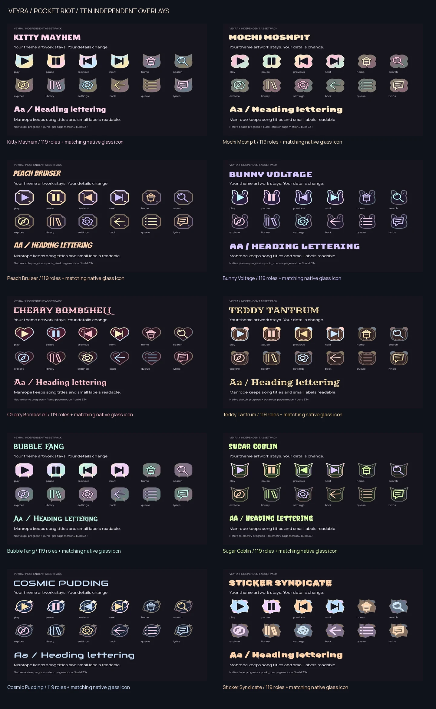
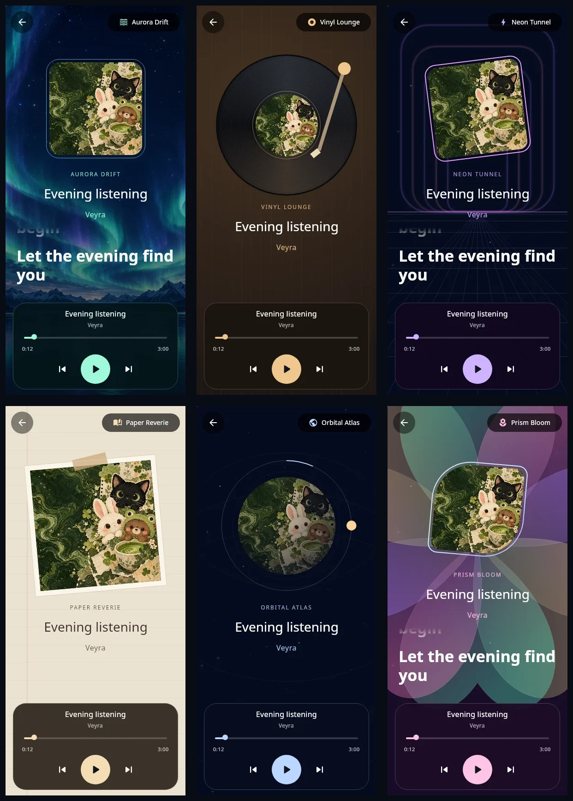
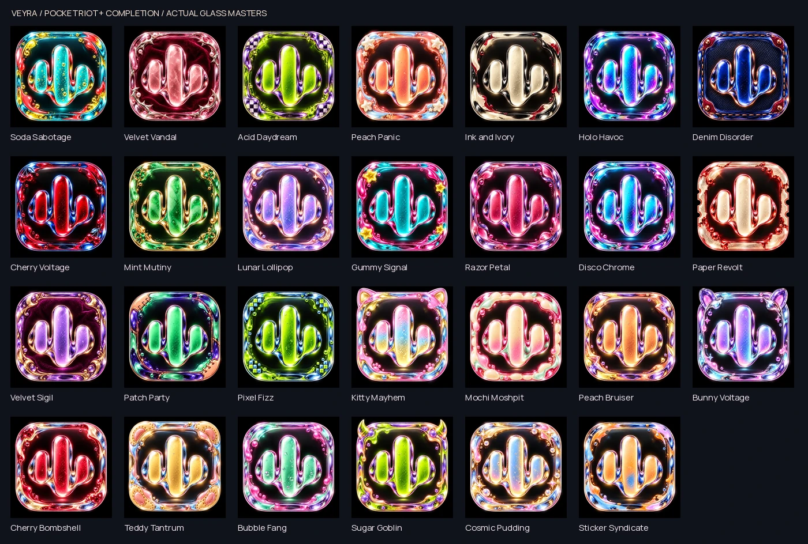

# Veyra 0.2.0

**Stable · Android code 50**
Promoted from completed **0.2.0-beta1 / code 46**.

## Your music, your details

| Collection | Stable 0.1.9 | Stable 0.2.0 |
| --- | ---: | ---: |
| Full themes | 62 | **72** |
| Independent asset packs | 15 | **32** |
| Bundled launcher choices | 105 | **132** |
| Navigation designs | 3 | **16** |
| Scroll-player motion choices | Original | **15** |

### Build 50 · six new immersive worlds

| Mode | Design |
| --- | --- |
| **Aurora Drift** | Original AI northern lights, a floating sleeve and luminous lyrics |
| **Vinyl Lounge** | Turning record with your artwork at its center, warm lighting and a stationary tone arm |
| **Neon Tunnel** | Violet/pink portals and a perspective midnight grid |
| **Paper Reverie** | A taped sleeve, warm notebook paper and a serif song title |
| **Orbital Atlas** | Album planet, orbiting moon, stars and an actual playback-progress ring |
| **Prism Bloom** | Colored glass petals and a sculpted sleeve with synchronized lyrics |

The original six remain available: **12 modes total**. The gallery has static matching previews;
each mode keeps the same playback, seek, exit and account behavior. Scene motion stops
when paused, inactive or reduced motion is selected. Existing theme/asset selections stay saved.

[Implementation and verification](verification/IMMERSIVE-EXPANSION-0.2.0-BUILD-50.md).

### Build 49 · more reliable controls and screen lifetimes

- Reconcile volume with the device's actual volume step after release; honor reduced motion.
- Keep scrub state tied to its track and current playhead; reject cancelled Canvas results.
- Release mini-player pulls and scrolling-panel state when their views disappear.
- Use current swipe callbacks and respect reduced motion for the sleeve's movement.
- Tie artist/playlist/Spotify loading to each visit and stop departed-page work; protect history and song-menu replies.
- Keep stale Like failures from rolling back newer player/notification choices; serialize rating requests.
- Handle missing video versions without null-map errors or repeated immediate lookups; bound the cache and retry transient failures.
- Filter blank Home continuation tiles and keep startup fallback catalogs from replacing fresh online catalogs.
- Let immersive controls scroll on short screens with large text.

[Review scope, regression checks and device-testing limits](verification/PATCH-0.2.0-BUILD-49.md).

### Build 48 · steady immersive controls and selected launch branding

- Fix the 5.5-second immersive-footer feedback loop: hiding the seek bar no longer reveals its own controls through cleanup.
- Fade controls in/out, retain reduced-motion behavior and renew the timer on deliberate interaction.
- Cancel unfinished seek gestures cleanly; completed gestures still commit once.
- Foreground branding uses the selected native icon and waits for its image instead of displaying a default placeholder.

[Patch details and verification limits](verification/PATCH-0.2.0-BUILD-48.md).

### Pocket Riot

Ten cute, bold overlays: **Kitty Mayhem, Mochi Moshpit, Peach Bruiser, Bunny Voltage, Cherry Bombshell, Teddy Tantrum, Bubble Fang, Sugar Goblin, Cosmic Pudding and Sticker Syndicate**.

Each contains 119 roles, separate pressed transport buttons, licensed fonts, progress/material presets and an offline specimen. Seven Chaos Studio overlays also join stable. Apply an overlay over a supported theme and choose which categories it replaces; the theme's artwork and palette remain.

### Every pack gets a matching icon

Twenty-seven new AI glass editions complete explicit launcher bindings for every theme and overlay. All 72 themes and 32 overlays have matching bundled choices, correctly grouped in the picker. Home shows the selected icon. Fourteen deep control icon names now resolve to existing theme assets, including immersive controls, expand arrows and account/edit/delete actions.

The original waveform identity remains. Unknown packs cannot request arbitrary Android components. Eleven aliases share byte-identical legacy foreground resources, removing 55 duplicate images while preserving every pixel, family mask and launcher choice.

### Chaos Studio + Motion studio

Ten original AI wallpaper worlds join stable: Soda Sabotage, Velvet Vandal, Acid Daydream, Peach Panic, Ink and Ivory, Holo Havoc, Denim Disorder, Cherry Voltage, Mint Mutiny and Lunar Lollipop. Each has 123 roles and separate pressed transports.

Choose **Silk, Soft Zoom, Rise, Drift, Reveal, Quick Cut, Velvet, Spring, Diagonal or Shutter**, or retain Theme default. Set Relaxed, Balanced or Quick pace and tap the live preview. Theme default preserves pack motion when pace changes. Navigation, Settings, the account panel and player settling honor the selected profile or timing; native gesture mechanics remain.

Choose among **16 navigation designs** and **15 scroll-player transitions**, with theme/asset glyphs and Liquid Glass compatibility in both navigation layouts. All motion is finite; reduced motion and the existing scroll-animation switch retain priority.

### Reliability and polish

- Liquid Glass composes with theme/asset materials without opaque fills hiding its effect; the separate mini-player honors it too.
- Reject stale/cancelled Library and account results before likes and continuation side effects. Refresh indicators respect request ownership; ratings update atomically.
- Refresh player geometry on scene-style changes and navigation drag geometry on size/direction changes. Skip unused glass exports.
- Clear cancelled-hold click suppression without adding a click after a completed hold.
- Prevent Theme/Asset Studio from hiding mid-Apply. Asset Studio adds search and All/Downloaded filters.
- Preserve existing themes, overlays, queue/Home/search options, immersive modes, widgets, fonts and prior playback fixes. Existing published pack bytes are unchanged.

## Install and source

Build/install **code 50** for the new immersive modes and latest fixes. Signing identity must match an existing installation for an in-place upgrade. This source update does not publish a signed APK.

[Stable source ZIP](downloads/Veyra_Android_Source_0.2.0_Stable.zip) · [SHA-256](downloads/Veyra_Android_Source_0.2.0_Stable.zip.sha256) · [Verification](verification/STABLE-0.2.0-PROMOTION.md) · [Completed beta notes](RELEASE_NOTES_0.2.0-beta1.md)

Source packages include native inputs, icon masters, licenses and backend provenance. Runtime ZIPs are included losslessly in an offline library. `python3 scripts/restore_source_packs.py` restores their exact bytes; `restore_theme_sources.py` also restores optional authoring assets. Font pools and preview aliases have strict path/hash rules, and existing edits are preserved. Generated gallery captures remain in Git and can be reproduced from included renderers.

Stable catalogs target `main`; the completed preview keeps its own URLs and source archive. Historical stable 0.1.9 remains on its branch. Focused compile/regression checks are documented; real-device FPS, every provider/device path and signed-APK publication are separate checks.
