# VEYRA / Night Vault

**Ten independent gothic and punk asset packs · 1,190 runtime roles · ten matching waveform launcher editions**

[Actual asset gallery](previews/night-vault/index.html) · [Font sources and licenses](../design/asset-fonts/NIGHT-VAULT-SOURCES.json) · [Build 38 fixes and verification](../verification/PATCH-0.1.9-BUILD-38.md)

Keep your selected theme or custom app style, then change its icons, lettering, controls, progress treatment and supported page motion. These packs preserve the underlying wallpaper, palette and theme selection. Individual layer switches remain available.

## The collection

| Pack | Display font | Material direction | Pack |
| --- | --- | --- | --- |
| **Cathedral Static** | UnifrakturCook | Pointed stained-glass tracery, cobalt/crimson accents, silver blackletter | [ZIP](packs/cathedral-static-v1.zip) |
| **Velvet Hex** | Grenze Gotisch | Plum medallions, silver crescents, delicate filigree | [ZIP](packs/velvet-hex-v1.zip) |
| **Razor Bloom** | New Rocker | Rose-cut seals, crimson thorns, sharp rocker lettering | [ZIP](packs/razor-bloom-v1.zip) |
| **Neon Séance** | Metal Mania | Cyan/violet geometric outlines and plasma progress | [ZIP](packs/neon-seance-v1.zip) |
| **Blackout Zine** | Pirata One | Torn cream/charcoal print, red poster marks, tape progress | [ZIP](packs/blackout-zine-v1.zip) |
| **Chrome Fang** | UnifrakturMaguntia | Fanged gunmetal panels, mint metal edges, blackletter | [ZIP](packs/chrome-fang-v1.zip) |
| **Candy Crypt** | Creepster | Pink batwing stickers, cream candy seals, playful horror type | [ZIP](packs/candy-crypt-v1.zip) |
| **Royal Ruin** | MedievalSharp | Gold crowns, sapphire heraldry, medieval headings | [ZIP](packs/royal-ruin-v1.zip) |
| **Acid Gargoyle** | Nosifer | Horned stone silhouettes, acid ink, dripping display type | [ZIP](packs/acid-gargoyle-v1.zip) |
| **Midnight Stitch** | Rye | Denim patches, silver embroidery, varsity/western type | [ZIP](packs/midnight-stitch-v1.zip) |

Each pack supplies **113 functional glyphs, four pressed transport skins and two fonts**. Manrope keeps body text readable. Display fonts are unmodified OFL files with their original notices; independent/imported user fonts keep priority.

## Actual runtime specimens

These sheets use the real supplied PNGs and fonts. Each image links to all 119 roles for that pack.

| Cathedral Static | Velvet Hex |
| --- | --- |
| [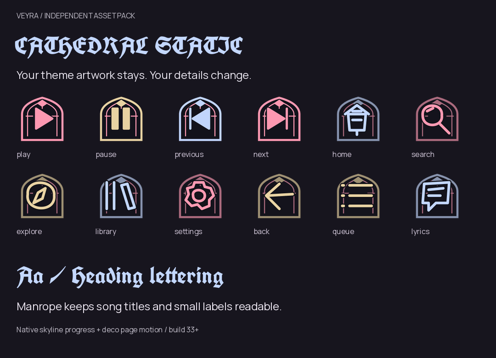](previews/cathedral-static/all-assets.png) | [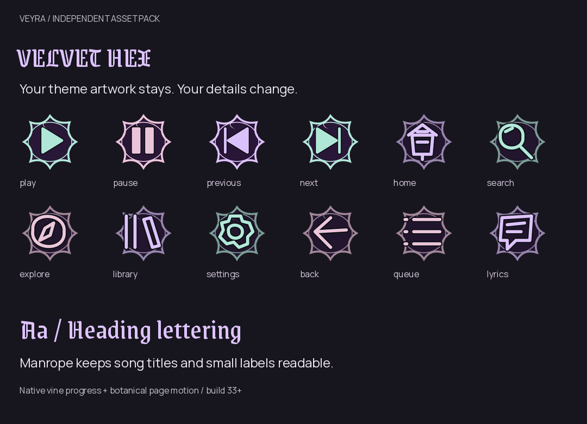](previews/velvet-hex/all-assets.png) |

| Razor Bloom | Neon Séance |
| --- | --- |
| [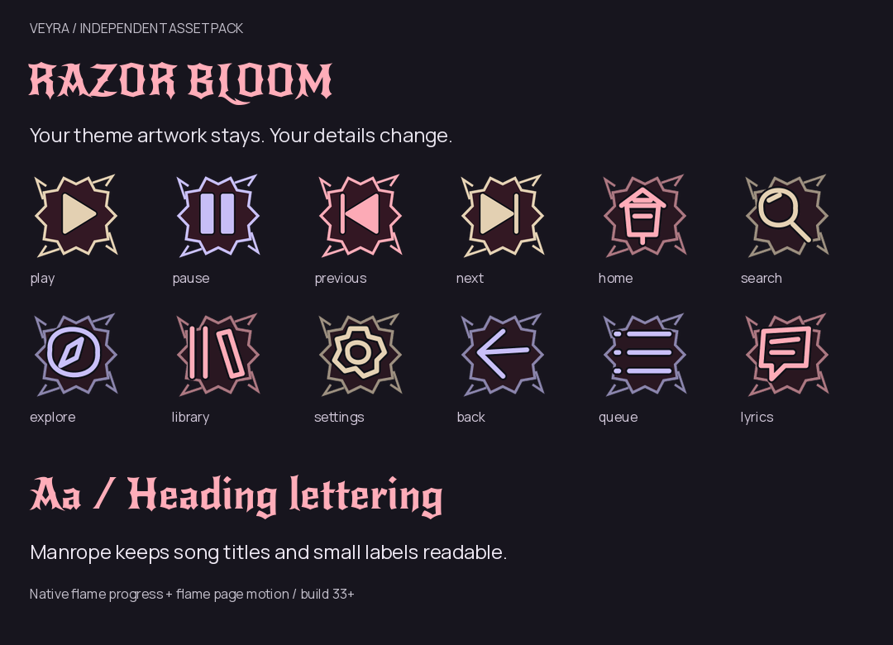](previews/razor-bloom/all-assets.png) | [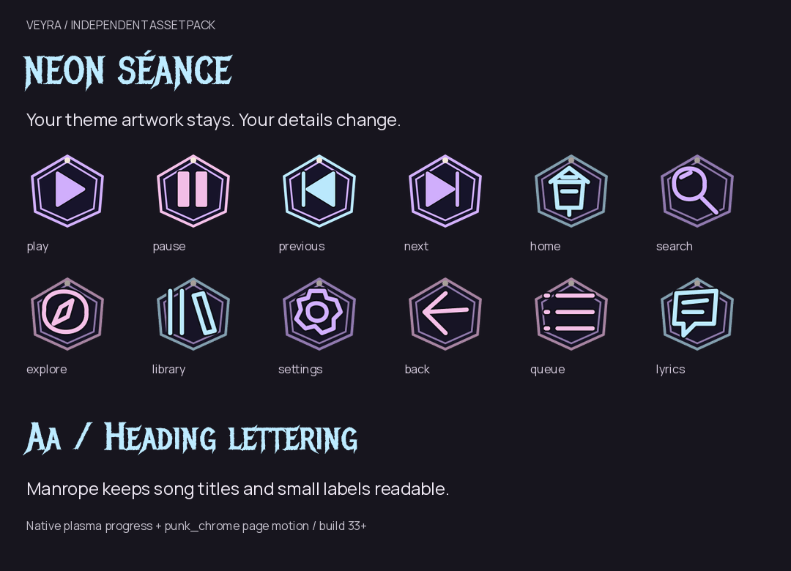](previews/neon-seance/all-assets.png) |

| Blackout Zine | Chrome Fang |
| --- | --- |
| [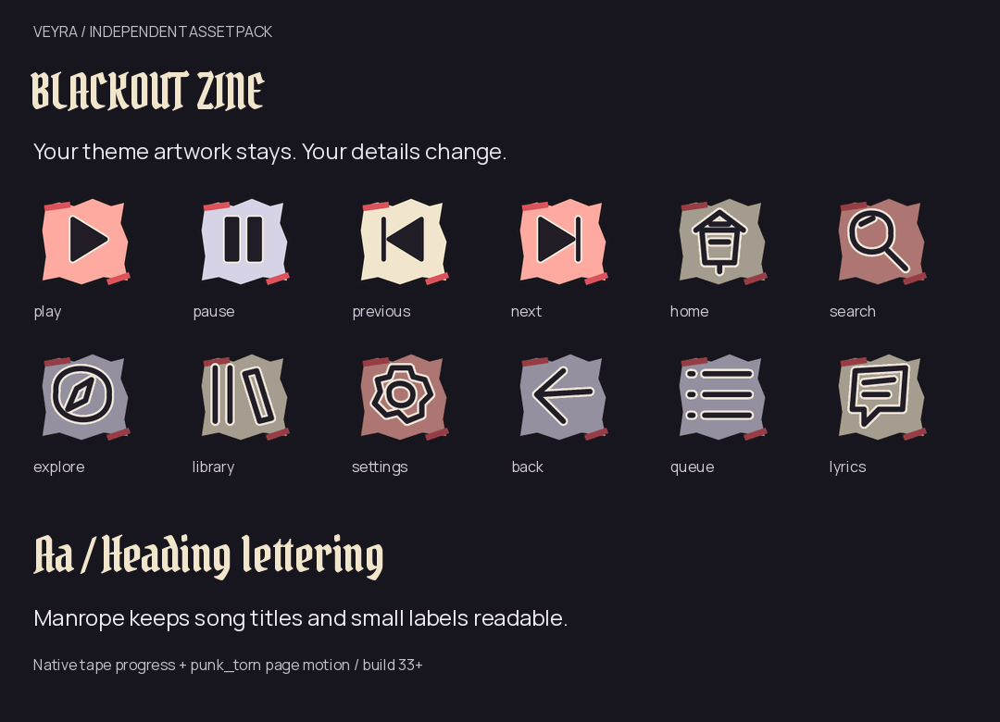](previews/blackout-zine/all-assets.png) | [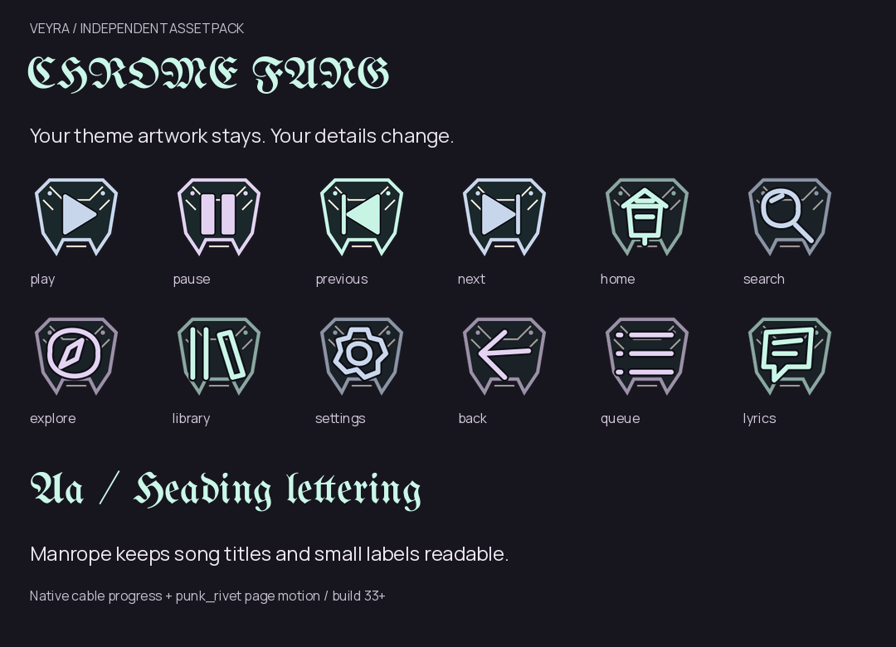](previews/chrome-fang/all-assets.png) |

| Candy Crypt | Royal Ruin |
| --- | --- |
| [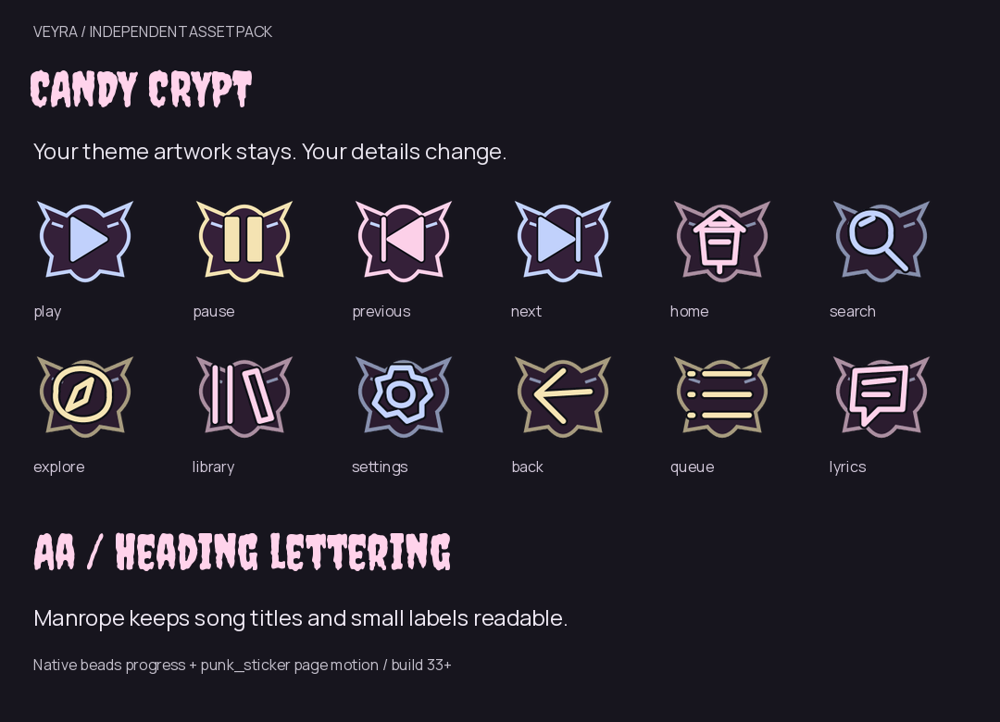](previews/candy-crypt/all-assets.png) | [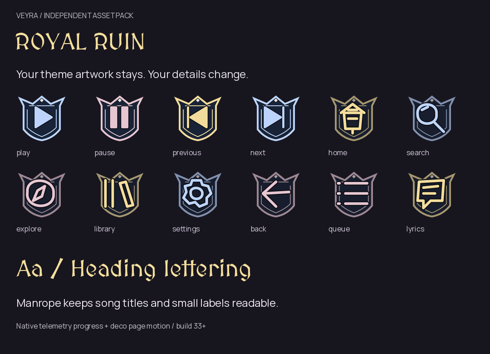](previews/royal-ruin/all-assets.png) |

| Acid Gargoyle | Midnight Stitch |
| --- | --- |
| [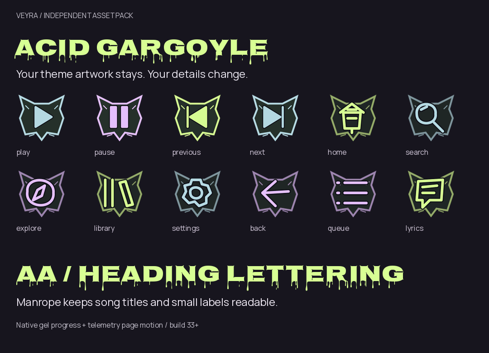](previews/acid-gargoyle/all-assets.png) | [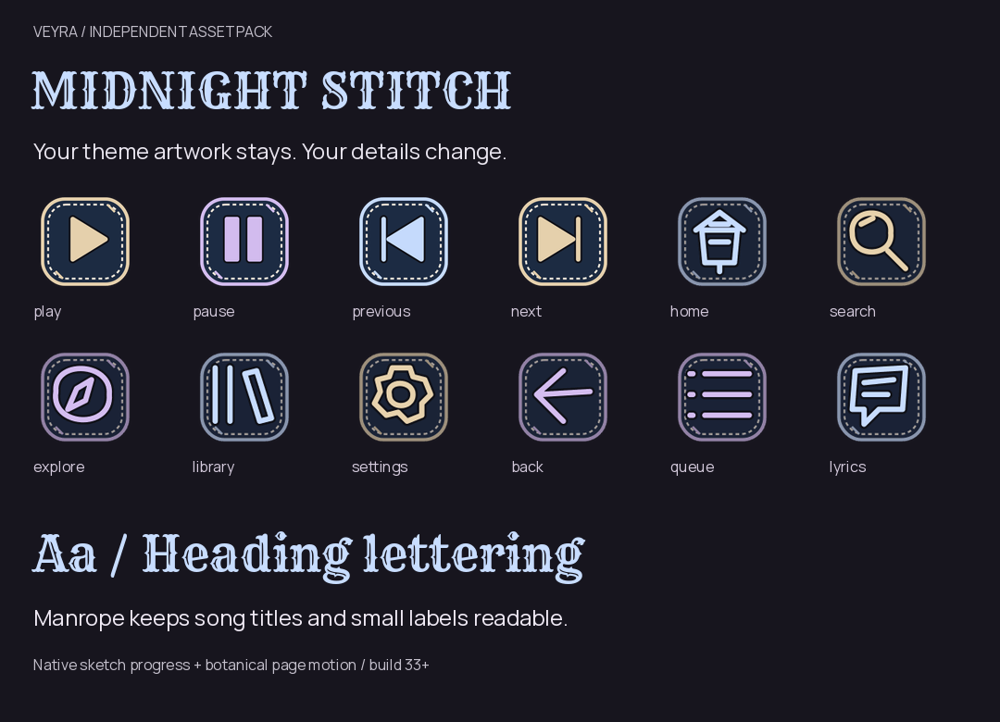](previews/midnight-stitch/all-assets.png) |

## Matching launcher icons

All ten use the existing canonical connected three-bar Veyra waveform, with distinct pack frames and shared Android monochrome branding. Build 39 replaces the earlier flat launcher illustrations with ten individually AI-generated glass designs: raised translucent waveforms, sculpted rims, reflections and distinct pack materials. The reviewed 512px WebP masters supply five native density exports; the earlier SVGs remain historical studies only. See [generation provenance](../design/launcher/night-vault/generated-sources.json) and the [actual glass icon gallery](../design/launcher/night-vault/previews/index.html). [Masters and catalog](../design/launcher/night-vault/catalog.json).

| Cathedral | Velvet | Razor | Neon | Blackout |
| --- | --- | --- | --- | --- |
| 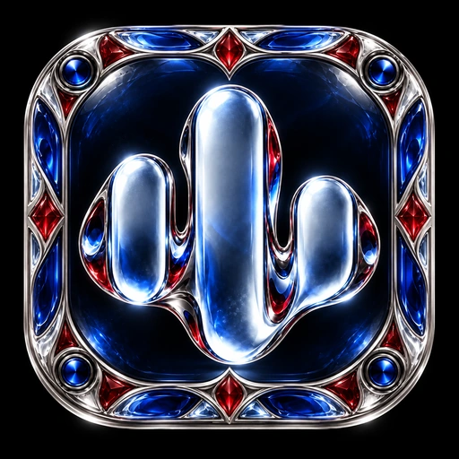 | 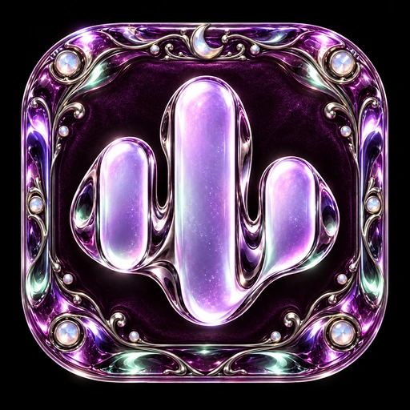 | 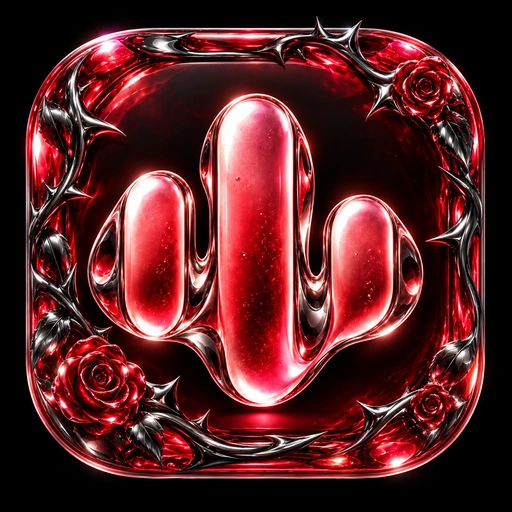 | 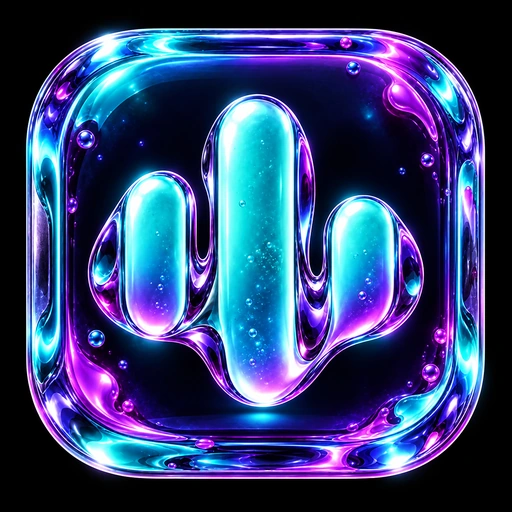 |  |

| Chrome | Candy | Royal | Acid | Midnight |
| --- | --- | --- | --- | --- |
| 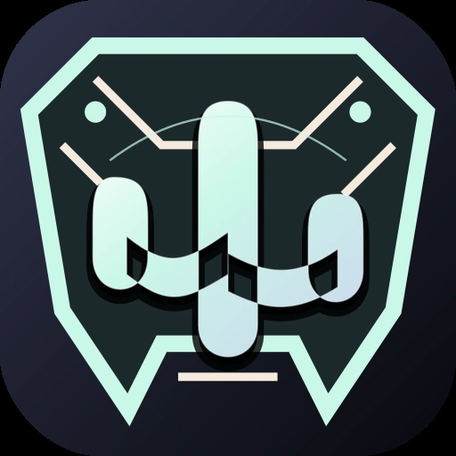 | 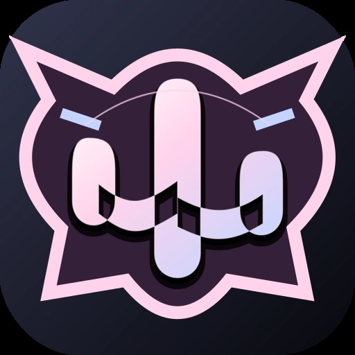 | 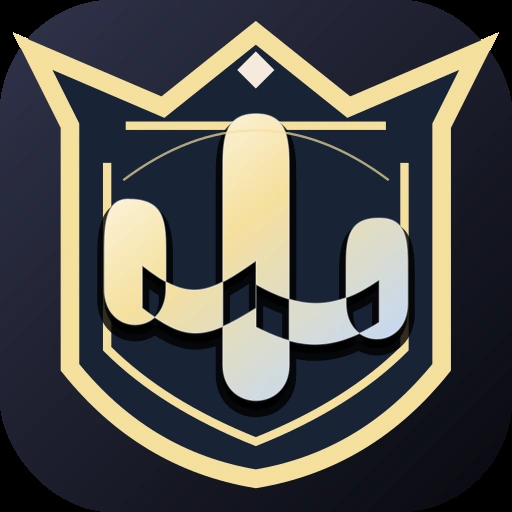 | 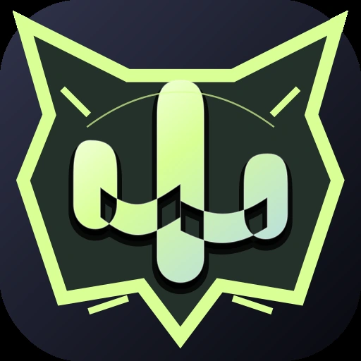 |  |

## Use and compatibility

Settings → Appearance → Asset packs → Refresh → download a Night Vault pack → **Apply assets**. Use the matching-icon action or App icon → Asset packs to choose its launcher edition. Home follows the actual selected launcher.

The pack format and native material/seek/motion presets remain compatible with **app code 33+**. The ten new bundled launcher aliases, playback/Home fixes and revised immersive menu require a rebuilt **stable 0.1.9 / code 38** APK; the redesigned glass launcher artwork requires **code 39**. Data packs and source ZIPs are not APKs. No old theme/asset pack is removed or repacked.

Original SVGs remain in `vectors/<pack>/`. Flat-color runtime exports use bounded 128px indexed PNGs, with 256px player transports. Pack activation keeps the existing small glyph warmup, off-main font cache and independent layer controls. Materials and page/press feedback use finite supported native presets; physical fabric/metal simulations are not installed.

## AI direction versus shipped assets

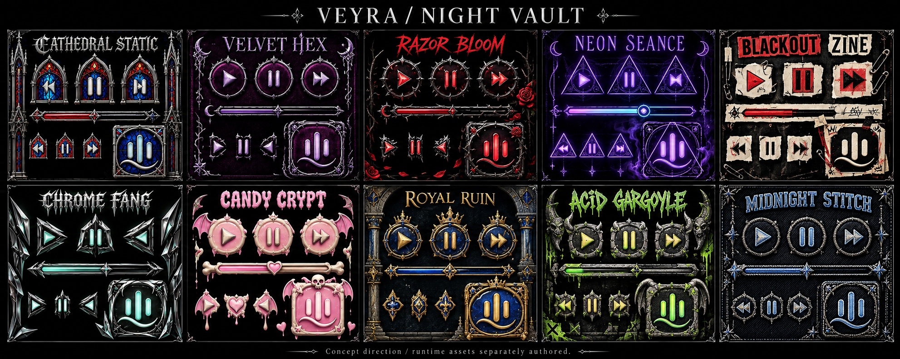

This original AI image is **concept art**. Its illustrated materials and lettering are separate from the real runtime specimens above. It is not an app screenshot. The actual launcher masters are separate AI-generated glass icons based on Veyra's existing connected-wave identity; runtime controls are individually authored functional SVG exports, not crops of this board.
