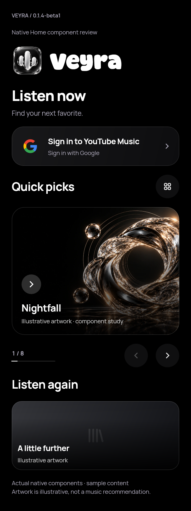

# Home refinement — 0.1.4-beta1

Native **component review boards** using the production Home controls, bundled fonts, real Google icon paths and existing Veyra artwork. Sample titles/images are illustrative; these are not complete Android app screenshots or live music recommendations. Android continues to use the existing brand/waveform components.

| State | Review image |
| --- | --- |
| Featured banner and account prompt | [banners.png](banners.png) |
| Mixed large/small tiles | [tiles.png](tiles.png) |
| Current track treatment | [playing.png](playing.png) |
| Missing artwork fallback | [fallback.png](fallback.png) |
| Empty feed and refresh | [empty.png](empty.png) |
| 320dp / 1.6× text | [large-text.png](large-text.png) |
| Right-to-left layout | [rtl.png](rtl.png) |
| Light appearance | [light.png](light.png) |
| Reduced motion | [reduced.png](reduced.png) |

[Reproduce renders and checks](../../verification/home-preview/README.md) · [Results and Android limits](../../verification/HOME-REFINEMENT-RESULTS.md).
