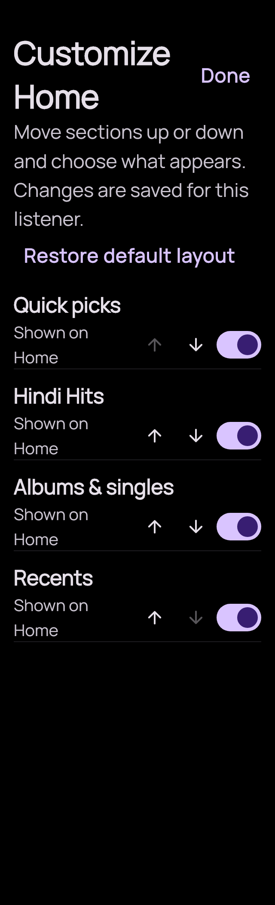
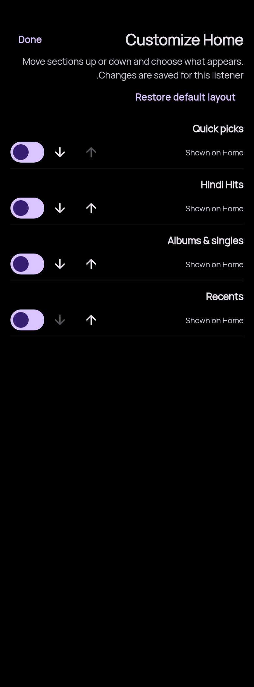
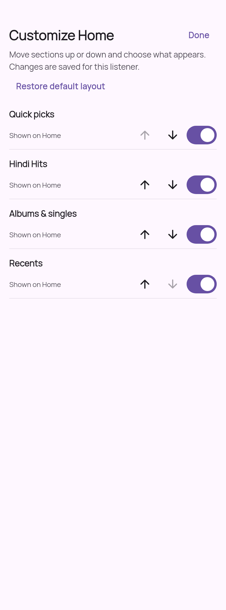

# Home 0.1.6-beta1 · component review

Actual native HomeExperience component bodies with generated production strings and bundled Manrope. Component arrangements only; these are not full Android screenshots or proof of live cache/navigation/playback behavior.

| Scene | Preview |
| --- | --- |
| Offline Home controls |  |
| Saved Home controls |  |
| Section editor |  |
| 320dp / 1.6x text |  |
| Right-to-left |  |
| Light theme |  |

[Reproduce](../../verification/home016-preview/README.md) · [Verification limits](../../verification/HOME-0.1.6-beta1-RESULTS.md).
