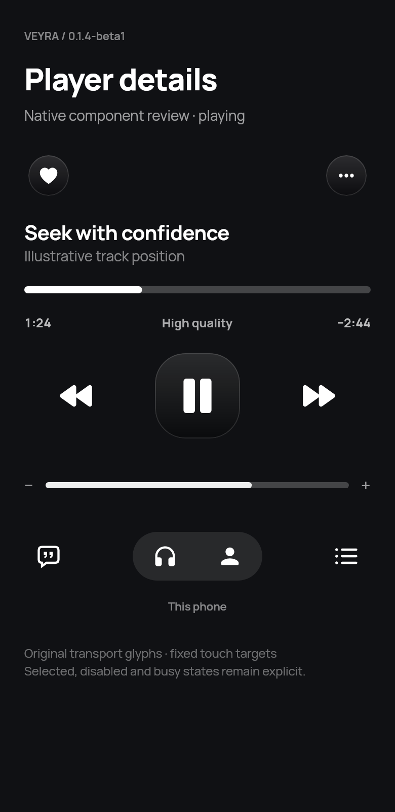

# Player details — 0.1.4-beta1

These are native Compose **component review boards**, using the production control primitives, original transport vector paths and bundled fonts. They show representative arrangements and sample data; they are not complete Android player screenshots. Actual artwork, lyrics, queue reordering and playback require Android/device verification.

| Review | Image |
| --- | --- |
| Playing / bold transport | [playing.png](playing.png) |
| Paused / play action | [paused.png](paused.png) |
| Buffering / stable control footprint | [buffering.png](buffering.png) |
| Disabled skip controls | [locked.png](locked.png) |
| Lyrics selection | [lyrics.png](lyrics.png) |
| Queue selection / playback modes | [queue.png](queue.png) |
| Compact transport components | [compact.png](compact.png) |
| Reduced-motion treatment | [reduced.png](reduced.png) |
| 320dp / 1.6× text | [large-text.png](large-text.png) |
| Right-to-left timeline | [rtl.png](rtl.png) |

[Reproduce renders and 22 interaction checks](../../verification/player-preview/README.md) · [Results and limits](../../verification/PLAYER-REFINEMENT-RESULTS.md).
