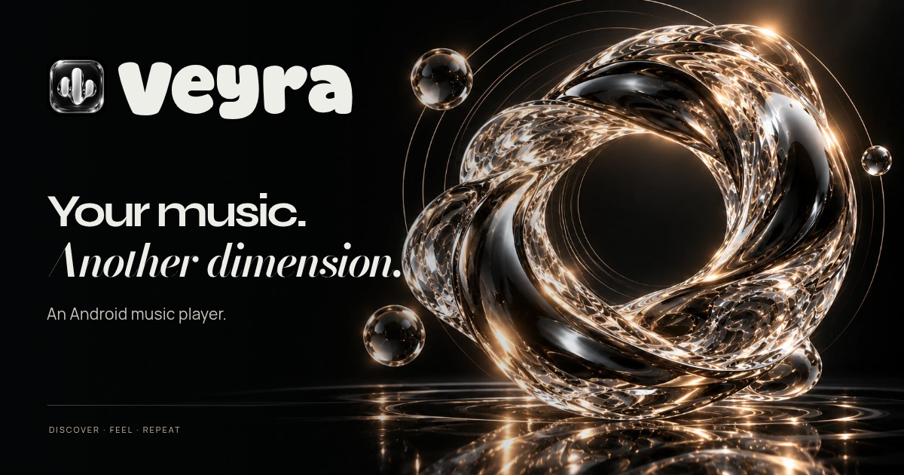

# Veyra / Media kit 1.0.0

Original liquid-glass campaign artwork built around Veyra's actual glass-waveform icon and Super Malibu wordmark. Obsidian, platinum and restrained champagne light match the website. These are promotional graphics, not Android screenshots.

## Preview everything locally

Extract the complete media-kit ZIP and double-click **index.html**. All twelve exports have previews, dimensions and download links. This offline gallery needs no npm install or internet connection. On GitHub, open the image links below; GitHub displays Markdown and images but does not run the HTML gallery.

The full website ZIP also includes this folder at `public/media-kit/`. Start the website normally and open **Media kit** in the footer for the animated gallery, category filters and keyboard-accessible image preview.

| Image | Pixels | Use |
| --- | --- | --- |
| [Link-sharing card](social/veyra-share-card-v1.jpg) | 1200 × 630 | Primary thumbnail for WhatsApp and other link previews. |
| [App campaign banner](banners/veyra-app-banner.png) | 2560 × 1440 | Large landscape artwork for the website and app showcase. |
| [GitHub social banner](banners/veyra-github-social.png) | 1280 × 640 | Repository social-preview upload and README banner. |
| [Square showcase post](posts/veyra-square-post.png) | 1080 × 1080 | Square campaign artwork for posts and image galleries. |
| [Portrait story](posts/veyra-portrait-story.jpg) | 1080 × 1920 | Vertical promotional artwork for mobile stories and status posts. |
| [Feature graphic](banners/veyra-feature-graphic.png) | 1024 × 500 | Wide promotional format, sized for a 1024 by 500 feature slot. |
| [Transparent brand lockup](brand/veyra-lockup-transparent.png) | 1600 × 600 | Real app icon with the Veyra wordmark; transparent outside the graphic. |
| [Website icon · 192](brand/veyra-web-icon-192.png) | 192 × 192 | Website/bookmark icon derived from the original app artwork. |
| [Website icon · 512](brand/veyra-web-icon-512.png) | 512 × 512 | Website/bookmark icon derived from the original app artwork. |
| [Apple touch icon](brand/veyra-apple-touch.png) | 180 × 180 | Website/bookmark icon derived from the original app artwork. |
| [Browser favicon PNG](brand/veyra-favicon.png) | 32 × 32 | Website/bookmark icon derived from the original app artwork. |
| [Original app icon](brand/veyra-app-icon-original.png) | 1254 × 1254 | Unchanged high-resolution glass-waveform app artwork. |

## Website link previews

Use `social/veyra-share-card-v1.jpg` as the Open Graph and Twitter large-image card. It is an optimized 1200 × 630 JPEG with clear branding and safe margins. The website includes its metadata in the initial HTML, so preview crawlers do not need JavaScript.

The website has not been deployed yet. No production domain or canonical address has been invented. Its temporary absolute image URL points to this public GitHub artwork folder. Once the website address is known, set `siteUrl` in `social.config.mjs` to the actual HTTPS address and rebuild. Alternatively set the build environment variable `SITE_URL`. Vercel's production-domain variable is supported automatically. The build then emits the correct canonical address, `og:url` and image address on the website's own domain. The image must stay publicly accessible without login.

WhatsApp and other apps choose their own preview layout and cache results; local gallery examples are demonstrations. A live WhatsApp fetch can only be checked after the website is public. If the card is changed later, use a new image filename and rebuild to avoid stale image caches.

For this GitHub repository's social preview, upload `banners/veyra-github-social.png` in repository **Settings → General → Social preview**. Committing the file does not change that repository setting automatically.

## Artwork and editable sources

`artwork/` includes the two full-resolution generated PNG backgrounds and optimized WebP counterparts. Campaign typography and the real app icon were composed precisely in browser-rendered artboards; text was not baked into an AI-generated imitation of the logo. The icon master is copied unchanged from the Android project's `design/launcher/wave_glass.png`.

The website source ZIP contains editable `tools/media-artboards.html`, local fonts and `scripts/render-media.mjs`. After installing website dependencies, run `npx playwright install chromium` if no browser is installed, then `npm run media:render` followed by `npm run media:gallery`. A custom Chromium executable can be supplied through `PLAYWRIGHT_CHROMIUM_EXECUTABLE_PATH`. Rebuild the website after regenerating public assets.

The 1024 × 500 export is a feature-graphic format, not a claim of app-store approval. The transparent lockup has a transparent outer canvas; the original icon retains its own dark tile. Browser icons, Apple touch icon and favicon are included; these do not change the Android launcher.

## Provenance and permitted use

Two original AI-generated backgrounds were created for this Veyra campaign on 18 October 2026. Final branding exports use the owner's actual app artwork. Super Malibu embedding and public source redistribution were explicitly authorized by the owner. Other bundled website fonts retain their accompanying font notices in the website source. This media kit is for showcasing Veyra; it does not independently relicense the app icon, trademark or font files. Do not extract a font from these graphics as a separate font distribution.

No obsolete support/UPI artwork is included.
