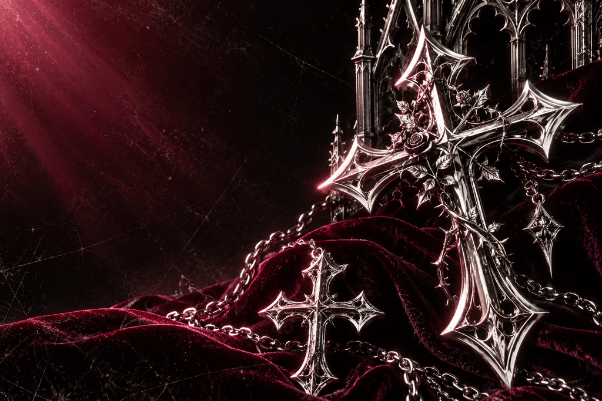
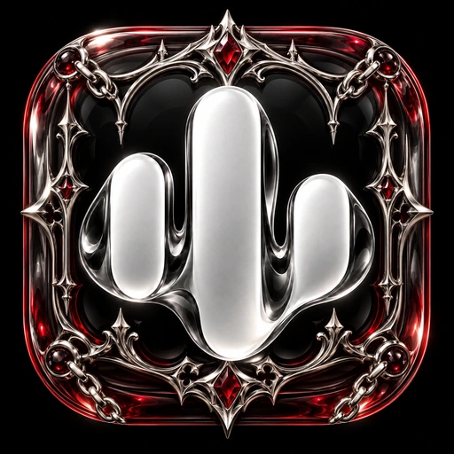
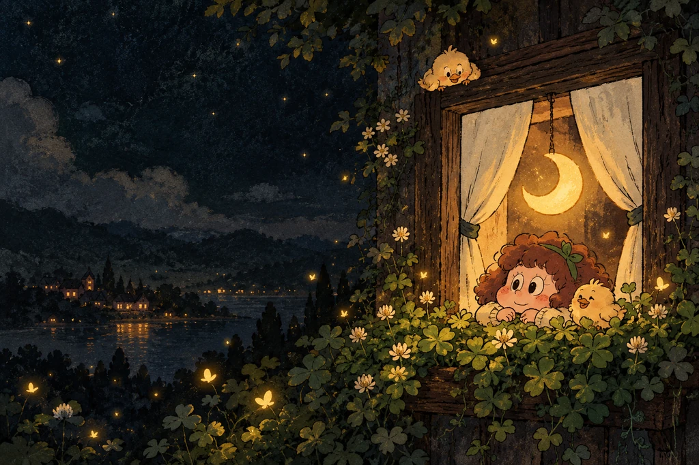
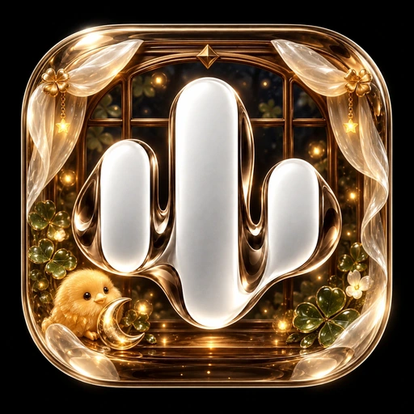
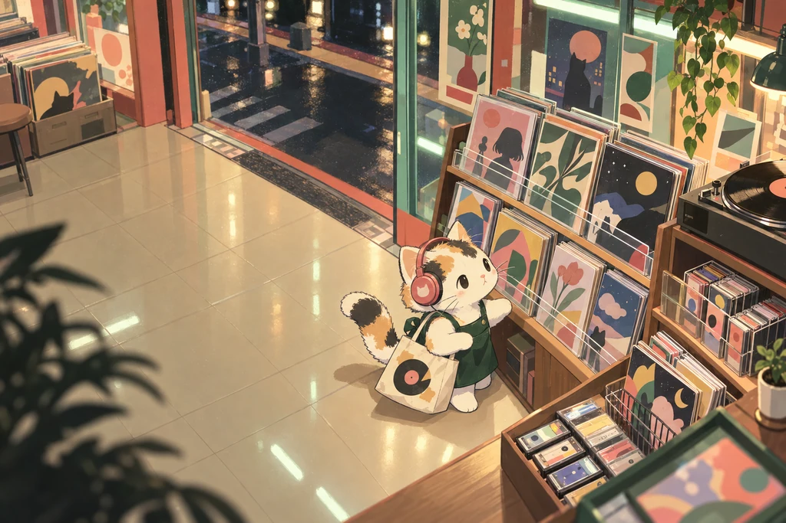
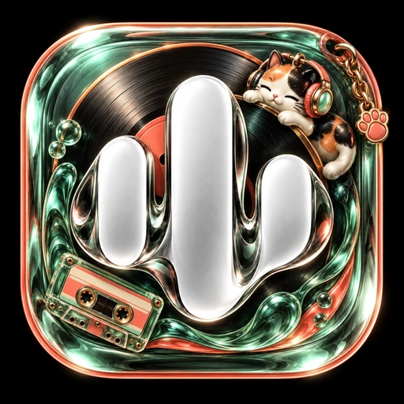
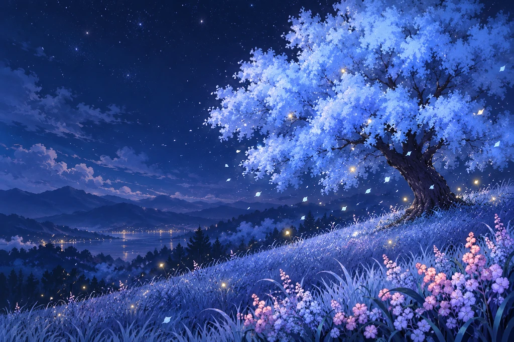
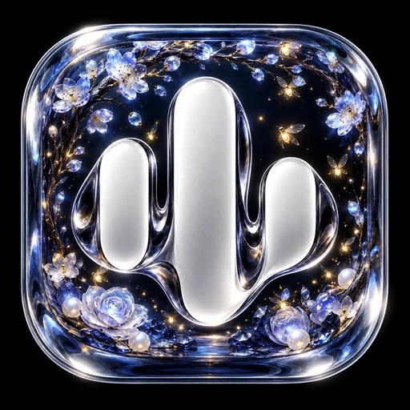
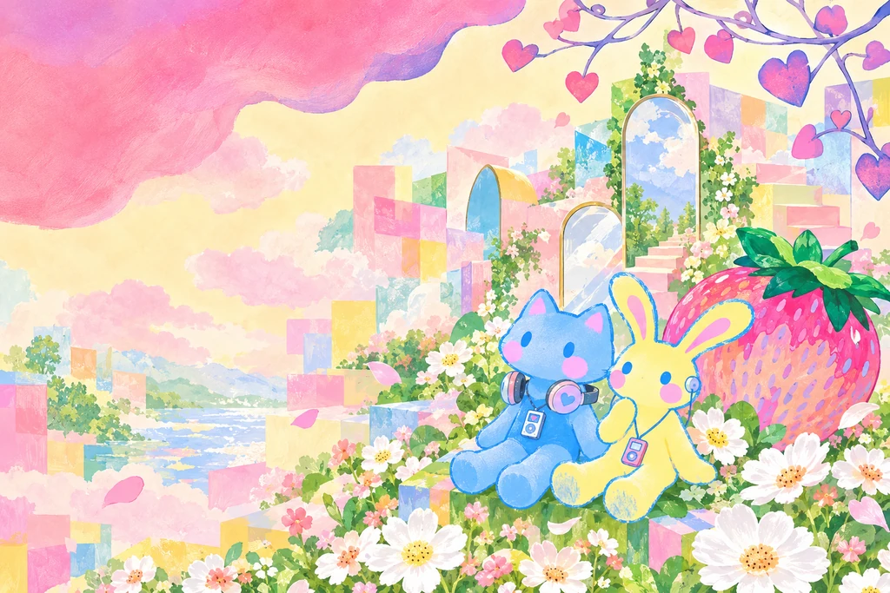
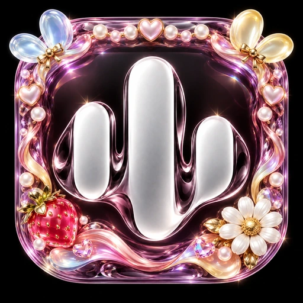

# Dreamscape — five more Veyra worlds

**Latest preview: 0.1.7-beta1 / code 25.** Twenty-one themes and 49 launcher choices; stable 0.1.6 remains separate.

Open **Settings → Appearance → Theme studio → Refresh**, choose a theme and Download → Apply. Use the explicit **Also use the matching launcher icon** option if wanted. Rebuild the latest preview source for the five new bundled launcher aliases. Theme packs are not APKs and cannot add launcher aliases by themselves. Stable 0.1.6 does not support these min-code-25 packs.

| Theme | Art and interface direction | Download |
| --- | --- | --- |
| **Chrome Vesper** | Chrome cruciform filigree, black velvet and garnet light. Gothic headings, cathedral navigation glyphs, faceted transport and an optional silver-chain Glass Noir icon. | [ZIP](packs/chrome-vesper-v1.zip) · [SHA-256](packs/chrome-vesper-v1.zip.sha256) |
| **Window Wish** | A moonlit walnut window, clover and original golden chick friends. Fredoka headings, moss-and-cream controls, window navigation glyphs and an optional crescent-window Glass Noir icon. | [ZIP](packs/window-wish-v1.zip) · [SHA-256](packs/window-wish-v1.zip.sha256) |
| **Cassette Corner** | An original calico record-shop cat, mint fluorescent light and coral cassette shelves. Bold Rajdhani, tape-deck controls, record navigation glyphs and an optional miniature cassette Glass Noir icon. | [ZIP](packs/cassette-corner-v1.zip) · [SHA-256](packs/cassette-corner-v1.zip.sha256) |
| **Azure Bloom** | Luminous blue blossom canopy, pink wildflowers and golden fireflies. Space Grotesk headings, moonstone controls, blossom navigation glyphs and an optional tree-under-glass Veyra icon. | [ZIP](packs/azure-bloom-v1.zip) · [SHA-256](packs/azure-bloom-v1.zip.sha256) |
| **Strawberry Daydream** | Pastel cut-paper cat and bunny friends, strawberries and ivory daisies. Fredoka headings, readable plum controls, heart-and-petal glyphs and an optional strawberry-charm Glass Noir icon. | [ZIP](packs/strawberry-daydream-v1.zip) · [SHA-256](packs/strawberry-daydream-v1.zip.sha256) |

## More than wallpaper

Each pack provides original AI scene artwork for Home/player/backdrop, matching Home branding, licensed bold heading and body fonts, a readable nine-color palette, thirteen functional glyphs, control geometry and timeline style. Their navigation glyphs and play/pause silhouettes have distinct motifs while retaining their familiar meanings. Cassette Corner also has a tape-deck queue emblem.

The existing themed bottom bar carries each palette, corner geometry and static light-line, route or bubble detail. App/system reduced motion remains supported; these additions introduce no animated wallpaper, permanent ticker or new dependency. Real album artwork, Google accounts, guest Listen Together, queue and playback actions remain native.

Matching launcher choice is optional and independent of theme removal. Every earlier launcher choice, all twelve Glass Atelier icons and all sixteen previous catalog themes remain available. New icons preserve the official silver Glass Noir waveform, surrounded by crafted theme objects instead of replacing it with a mascot.

## Scenes, icons and native previews

The scenes and matching icons below are AI-generated/edited assets. Linked interface images are **native Compose component studies with illustrative surroundings, not Android screenshots**. Sample player covers are demonstration art; the app retains real music artwork.

### Chrome Vesper

[Home](previews/chrome-vesper/home.webp) · [Player](previews/chrome-vesper/player.webp) · [RTL navigation / large text](previews/chrome-vesper/navigation-rtl-large-text.webp)

### Window Wish

[Home](previews/window-wish/home.webp) · [Player](previews/window-wish/player.webp) · [RTL navigation / large text](previews/window-wish/navigation-rtl-large-text.webp)

### Cassette Corner

[Home](previews/cassette-corner/home.webp) · [Player](previews/cassette-corner/player.webp) · [RTL navigation / large text](previews/cassette-corner/navigation-rtl-large-text.webp)

### Azure Bloom

[Home](previews/azure-bloom/home.webp) · [Player](previews/azure-bloom/player.webp) · [RTL navigation / large text](previews/azure-bloom/navigation-rtl-large-text.webp)

### Strawberry Daydream

[Home](previews/strawberry-daydream/home.webp) · [Player](previews/strawberry-daydream/player.webp) · [RTL navigation / large text](previews/strawberry-daydream/navigation-rtl-large-text.webp)

## Provenance and rebuilding

Ten AI generations/edits used the owner's reference images for mood and the official `design/launcher/wave_glass.png` for icon identity. Source reference attachments are not redistributed. Dreamer, chick, cat and bunny designs are original; no third-party character or retail logo is claimed. Chrome Vesper uses original cruciform ornament and chain compositions. Fonts retain their included SIL Open Font License notices, including the original Gothic font notice. Existing project attribution remains intact.

SVG sources for functional glyphs are under `source-icons/<theme>/`; the reviewed icon masters are under `launcher-art/`. Rebuild only these packs offline with `python3 themes/build_dreamscape_collection.py`. The existing immutable compiler supports both upstream font-notice locations; existing published assets are unchanged. All five v1 pack hashes are fixed after publication; future artwork updates require a new pack version.

Manifest-derived `render-config/` files drive the existing preview renderer. Generated images under `themes/previews/` remain in the repository/gallery and are omitted from source ZIP duplication; source, renderers and theme assets/packs are retained.

[Verification and device limits](../verification/DREAMSCAPE-COLLECTION-0.1.7-beta1.md) · [All themes](README.md)
