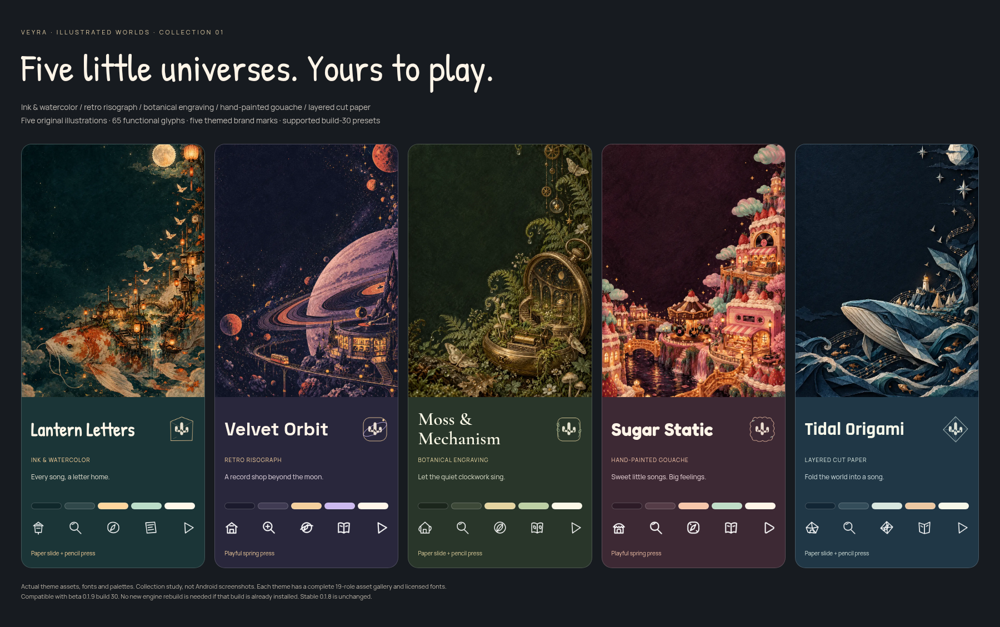

# Illustrated Worlds · five special illustration themes

**For Veyra beta 0.1.9, engine build 30 or newer.** These use the existing native sketch/playful presets. If build 30 is already installed, open Theme Studio → Refresh; another APK rebuild is not needed for these packs. Stable 0.1.8 and older betas cannot install them.

| Theme | Illustration, typography and native behavior | Download / every asset |
| --- | --- | --- |
| **Lantern Letters** | Ink-and-watercolor koi postal village, apricot lanterns, letter glyphs, Patrick Hand headings. Uneven paper shapes, pencil timeline and paper-slide/press-tilt preset. | [ZIP](packs/lantern-letters-v1.zip) · [SHA-256](packs/lantern-letters-v1.zip.sha256) · [Asset sheet](previews/lantern-letters/all-assets.png) · [Study](previews/lantern-letters/index.html) |
| **Velvet Orbit** | Retro risograph planets, vinyl rings and an orbital record shop. Space Grotesk headings, planetary compass glyphs, rounded controls and playful spring/bubble preset. | [ZIP](packs/velvet-orbit-v1.zip) · [SHA-256](packs/velvet-orbit-v1.zip.sha256) · [Asset sheet](previews/velvet-orbit/all-assets.png) · [Study](previews/velvet-orbit/index.html) |
| **Moss & Mechanism** | Botanical engraving-inspired watch observatory, fern fronds and brass mechanisms. Cormorant Garamond headings, leaf/gear glyphs and native sketch preset. | [ZIP](packs/moss-mechanism-v1.zip) · [SHA-256](packs/moss-mechanism-v1.zip.sha256) · [Asset sheet](previews/moss-mechanism/all-assets.png) · [Study](previews/moss-mechanism/index.html) |
| **Sugar Static** | Hand-painted gouache dessert record shops and cassette bakeries. Fredoka headings, confectionery glyphs and supported playful spring/bubble preset. | [ZIP](packs/sugar-static-v1.zip) · [SHA-256](packs/sugar-static-v1.zip.sha256) · [Asset sheet](previews/sugar-static/all-assets.png) · [Study](previews/sugar-static/index.html) |
| **Tidal Origami** | Layered indigo paper waves, a folded whale harbor and copper fish. Rajdhani headings, crease glyphs and supported paper-slide sketch preset. | [ZIP](packs/tidal-origami-v1.zip) · [SHA-256](packs/tidal-origami-v1.zip.sha256) · [Asset sheet](previews/tidal-origami/all-assets.png) · [Study](previews/tidal-origami/index.html) |

## Complete assets, cohesive behavior

Each pack maps nineteen roles: one illustration intentionally shared by header/player/Studio preview, thirteen transparent functional glyphs, an in-app Veyra brand badge, heading font and Manrope body font. Each has seventeen unique runtime asset files plus four license/attribution notices and its manifest. Across the collection there are five original AI illustrations, sixty-five glyphs and five brand treatments. The SVG sources are retained under `source-icons/<id>/`.

These are different illustrated worlds using supported native presets, not five new animation engines. Existing animation-off/subtle preferences and custom-style isolation remain respected. No sprites, downloaded scripts, invisible input handlers, reactive mascots or launcher aliases are added. Real song artwork remains the real song artwork.

The complete asset sheets and browser component studies use actual pack assets/fonts; they are not Android screenshots. Actual device frame rate has not been measured. Font files are unmodified, with their upstream OFL notices included. Artwork is original OpenAI-generated work; functional SVG glyphs and brand treatments are original Veyra assets.

## Build / source restoration

The reviewed background encodings are checked in. With CairoSVG available, run `python3 themes/build_illustrated_collection.py`. The builder refuses to change an existing version's ZIP bytes: bump the version before publishing changed assets. `python3 themes/render_illustrated_gallery.py /path/to/output` creates the self-contained HTML studies and copies assets; optional browser screenshots use Chromium/Playwright.

Compact project ZIPs store duplicate runtime images inside the included theme packs. Run `python3 scripts/restore_theme_sources.py` if editable image folders are needed; it checks hashes and preserves existing files. App font/license build inputs stay expanded.

[Focused verification](../verification/ILLUSTRATED-WORLDS-0.1.9-beta1.md)
