> **Latest beta build 31:** [Five Advanced Worlds](ADVANCED_WORLDS.md) bring 119 asset roles per theme, expanded Home/Player/Settings controls, native geometry, progress tracks and motion. [Compare all five](previews/advanced-worlds/collection.png). Beta now has **57 packs**; these five require the updated build-31 beta APK.

> **Five new beta illustration worlds:** [Lantern Letters, Velvet Orbit, Moss & Mechanism, Sugar Static and Tidal Origami](ILLUSTRATED_WORLDS.md). [Collection overview](previews/illustrated-worlds/collection.png). At that checkpoint beta had 52 packs; build-30 users can refresh/download them without another engine rebuild.

> **New in beta 0.1.9 / code 30: [Margin Notes](MARGIN_NOTES.md)** — the first special sketch preset, with a [complete asset sheet](previews/margin-notes/all-assets.png), hand-drawn controls and short native sketch motion. At that checkpoint beta had 52 packs; stable 0.1.8 keeps its existing 46. A refreshed beta APK is required for the new preset.

> **Stable 0.1.8:** independent fonts, All icons, cached Studio previews and stronger screen artwork are now included in stable. [Release notes](../RELEASE_NOTES_0.1.8.md).

# Veyra Theme Studio

**Stable: 0.1.8 / code 28 · Development preview: 0.1.9-beta1 / code 31.**

**New: [five Keepsake themes](KEEPSAKE.md), compatible with stable 0.1.7.** All 46 packs use the shared catalog. Stable 0.1.8 includes the five new launcher choices, searchable Studio and icon-picker refinements, for 74 launcher choices. Historical stable 0.1.7 retains 69.
Made by **Bhavishya Dalal**.

**Latest: [twenty Worlds themes — all fifteen proposed directions and five Quiet Horizons image themes](WORLDS.md). Rebuild the latest preview for the expanded catalog and new launcher aliases.**

**New: [five Wayfarer themes, creative Glass Noir icons and themed bottom navigation](WAYFARER.md).** Forty-six themes are now available.

**Latest: [five Dreamscape themes with more detailed Glass Noir icons and custom transport/navigation glyphs](DREAMSCAPE.md).**

| Theme | Its own atmosphere | Download |
| --- | --- | --- |
| **Midnight Express v1** | Original rainy night train, amber carriage lights, bold Rajdhani headings, route-style timeline and optional ticket-waveform icon | [Theme ZIP](packs/midnight-express-v1.zip) · [SHA-256](packs/midnight-express-v1.zip.sha256) |
| **Astral Tide v1** | Original bioluminescent ocean, bold Space Grotesk headings, sea-glass controls, champagne starlight and a manta-waveform icon | [Theme ZIP](packs/astral-tide-v1.zip) · [SHA-256](packs/astral-tide-v1.zip.sha256) |
| **Playtime Club v1** | Unofficial cartoon music party, Fredoka rounded headings, yellow/mint details, bubble timeline and soft press feedback | [Theme ZIP](packs/playtime-club-v1.zip) · [SHA-256](packs/playtime-club-v1.zip.sha256) |
| **Web Slinger v1** | Midnight city, crimson glass, cobalt webs, bold condensed type, angular action details and a web timeline | [Theme ZIP](packs/web-slinger-v1.zip) · [SHA-256](packs/web-slinger-v1.zip.sha256) |
| **Halloween Nocturne v3** | Moonlit forest, smoked glass, pumpkin amber, gothic headings and an ember timeline | [Theme ZIP](packs/halloween-nocturne-v3.zip) · [SHA-256](packs/halloween-nocturne-v3.zip.sha256) |

[Offline preview gallery](index.html) · [Catalog](catalog.json) · [Verification](../verification/THEMES-0.1.7-beta1.md)

## Make it yours

1. Use **stable 0.1.8** for its 46 stable-compatible packs and 74 launcher choices. Those packs also work on historical stable 0.1.7. Margin Notes/Illustrated Worlds need beta build 30 or newer; Advanced Worlds needs build 31. Theme ZIPs are not APKs. Tap catalog Refresh to see newly published packs.
2. Open **Settings → Appearance → Theme studio**. The compact collection shows
   Original, your themes and one App icon row. Filter All or Downloaded.
3. Tap a theme row to open its detail page. Preview, description and palette stay
   there; Download/Apply and cancellation remain reachable below the scroll area.
4. Download, then choose **Apply theme** and confirm. The appearance updates live
   while preserving your current screen and music. **Also refresh the interface**
   remains available when you want a full screen refresh; it is optional.
5. Open **App icon** in Studio or Appearance. Browse **Veyra**, **Glass** or
   **Themes** or **Glass Atelier**. Glass has Liquid, Samsung and Pixel groups, each with four variants.
   Both entry points open All; filter by collection when needed.
6. For the standard launcher icon choose **Veyra → Glass Noir · Default**.
   Choose **Original Veyra** in Studio to restore your saved appearance.

All 69 earlier launcher choices are retained. Stable 0.1.8 includes five Keepsake choices for a total of 74. Only the visible icon group is composed.
Headers stay reachable; grids, group filters and hints scroll within the chooser
on smaller displays. Icon changes run off the UI thread and are serialized with
selection reads so Activity recreation cannot read a half-finished icon switch.

Applying a theme does **not** silently change the launcher icon. Removing a theme
or choosing Original does not overwrite a manually chosen icon. Android launchers
may cache icon changes or apply their own monochrome themed-icon setting.

Catalog reads are shared while in flight and reused for ten minutes after success.
The explicit Refresh button always requests fresh data. Download installation
validates once before atomic publication; applying still revalidates the local
files, preserving corruption checks. Installed themes and Original remain offline.

## More than a new accent

| Component | Theme presentation | Preserved behavior |
| --- | --- | --- |
| Home branding | Matching Veyra icon and heading font; Web Slinger wordmark treatment | Accessible Veyra identity, responsive logo width and actual Home content |
| Main screens | Darkened local atmosphere, web/ember details, color and typography | Navigation, accounts, search, scroll and saved customization |
| Home artwork | Theme frames, caption gradients and decorative section rules | The listener's real album covers and playback actions |
| Navigation | Theme glyphs, readable tonal surface, radius, selected state and static timeline motifs | Labels, routes, gestures and accessibility roles |
| Player | Custom glyphs, button geometry, themed fill and web/ember playhead | Seek, RTL, elapsed/duration, busy/locked states, haptics and touch targets |
| Menus / Settings | Theme palette and sculpted action icon housings | Existing actions, account/offline requirements and sleep-timer state |
| Theme Studio | Compact lazy collection, separate detail page, saved swatches and fixed actions | Checksum validation, download/cancel, confirmation, offline use and removal rules |
| Android launcher | Stable: 69 choices. Beta: 74 choices, with adaptive icons and legacy fallbacks | One enabled launcher alias; user choice remains separate from theme selection |

Web details are drawn behind content without pointer handlers or continuous
animation loops. Native press feedback and existing reduced-motion preferences
remain. Service logos and specialty glyphs keep their original meaning.

## Native component previews

These are **Compose component studies, not complete Android device screenshots**.
They use real shared branding, Home frames, theme backgrounds, player controls,
Settings rows and Theme Studio preview components in illustrative compositions.
Music-cover examples are original demonstration artwork; the real app retains
its actual music artwork. Menu rows, navigation arrangement and Studio surrounding
content in the studies are illustrative; Android host windows are not reproduced.

| Web Slinger Home | Web Slinger player |
| --- | --- |
| 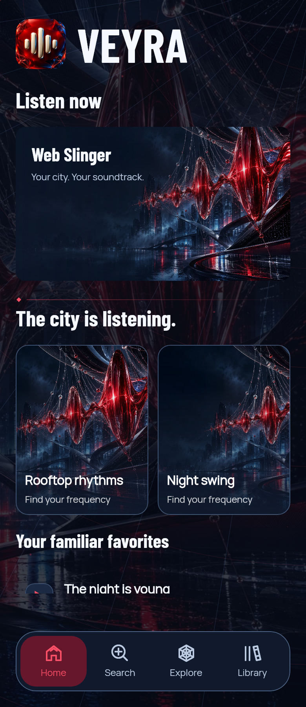 | 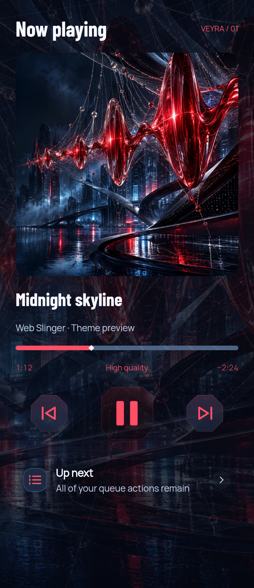 |

| Theme Studio | Studio at 320 dp / 150% text |
| --- | --- |
| 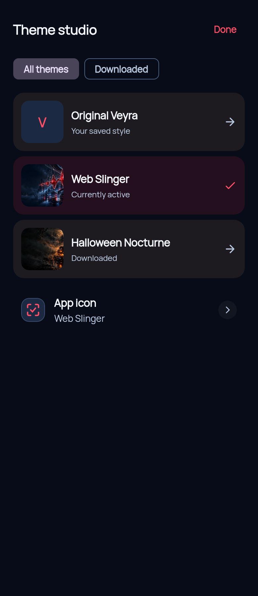 | 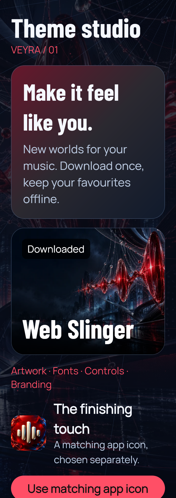 |

| Halloween branding | Halloween Theme Studio |
| --- | --- |
| 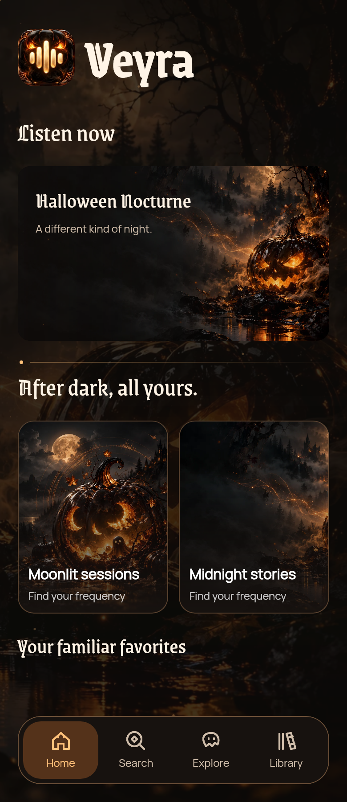 | 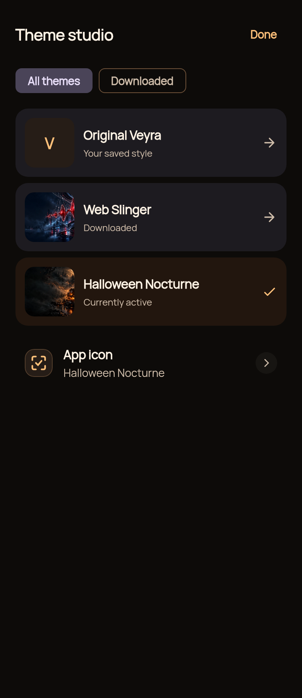 |

| Grouped icon choices | 320 dp / 150% text icon choices |
| --- | --- |
| 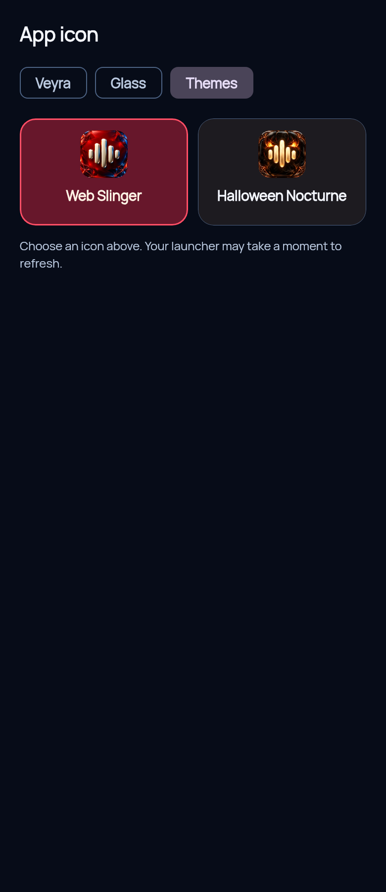 | 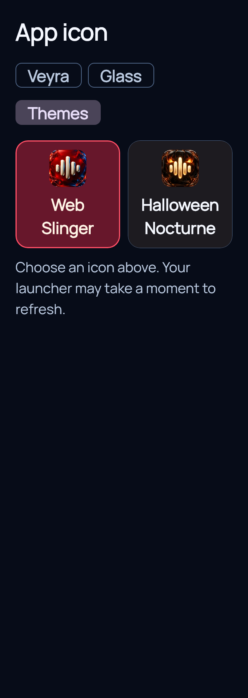 |

Additional [Web Slinger studies](previews/web-slinger) and [Halloween studies](previews)
include Settings, actions and large-text layouts.

## Compatibility and validation

Playtime Club uses **schema 3 / minimum app code 25**. Older apps show **Update Veyra first**. Web Slinger and Halloween v3 remain schema 2 / minimum code 24. Previously installed Halloween v1/v2 packs
remain supported by the new app. Existing published v1/v2 ZIPs stay immutable.
Theme updates download into a separate version directory and require explicit
Apply; a download never replaces the currently active theme definition.

Packs are data only. No scripts, executable layouts, component names, remote asset
references or arbitrary launcher icons can be supplied by a pack. Bundled icon
mapping recognizes only the five known theme IDs. Unknown themes cannot select an
Android component. Limits remain ZIP 12 MiB, 48 asset files, 8 MiB per file,
32 MiB unpacked, 2048-pixel artwork and 256-pixel glyphs/branding icons.

The catalog and downloads use exact repository HTTPS paths. The outer checksum,
every inner hash, manifest/app compatibility, safe paths, unpacked sizes, contrast,
geometry, image bounds and native font loading are validated before installation.
Failures preserve the previous installation; cancellation cleans temporary data.
Active themes cannot be removed. Original appearance and installed packs work offline.

## Rebuild and provenance

Run `python3 -m pip install -r themes/requirements.txt`, then
`python3 themes/build_themes.py`. Original assets and SVG sources are checked in;
no AI service or network access is needed for rebuilding. Published ZIPs cannot
be overwritten with changed bytes: bump their manifest version first.
`--replace-draft` is only for a theme version that has **not** been published.

The builder produces all five packs, checksums, catalog and Android icon densities.
Full atmosphere/fonts remain in downloadable packs; only the catalog and bundled
launcher artwork are added to Android resources. A theme ZIP is not a launcher
icon installation mechanism.

Original AI-assisted abstract artwork and original vector glyphs by Veyra.
Web Slinger is a web-and-city fan theme; no official comic/film artwork or brand
logo is included. Manrope, Barlow Condensed and Grenze Gotisch retain their
included SIL Open Font License notices. [Barlow Condensed source](https://github.com/google/fonts/tree/main/ofl/barlowcondensed)
· [Android adaptive icon reference](https://developer.android.com/develop/ui/views/launch/icon_design_adaptive).

## Playtime Club · a little joy, every play

A cozy blue cartoon music party with butter-yellow controls, mint bubbles and soft
rounded Fredoka headings. The theme reaches Home branding, navigation, player
controls/timeline, action emblems and Settings surfaces. Real music covers remain
unchanged. Gentle spring press feedback stops at rest and respects reduced motion.
The matching smiling waveform launcher is optional; choosing a theme does not
silently change the device icon.

| Home | Player |
| --- | --- |
| 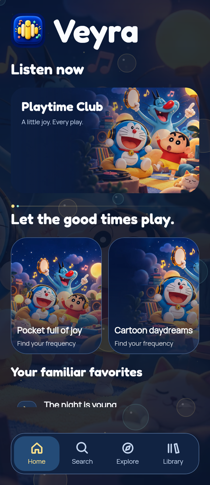 | 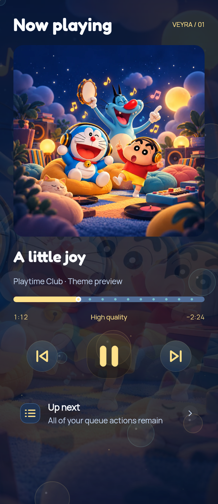 |

[All seven native studies](previews/playtime-club) include 320 dp / 150% text Home
and Theme Studio. Open **index.html** locally for the complete preview gallery.
These are shared native components in illustrative layouts, not device screenshots.

Character artwork is an **unofficial fan illustration**, without affiliation or
endorsement. Doraemon: Fujiko-Pro / Shogakukan / TV Asahi / Shin-Ei Animation.
Crayon Shin-chan: Yoshito Usui / Futabasha / Shin-Ei Animation / TV Asahi.
Oggy: Xilam Animation. These credits do not grant character rights. Original
Veyra interface glyphs and waveform icon are distinct from the fan illustration.
See [artwork notice](playtime-club/licenses/ARTWORK.txt) and included font licenses.
Fredoka font source: https://github.com/google/fonts/tree/main/ofl/fredoka .
Design reference search: https://www.pinterest.com/search/pins/?q=cartoon%20music%20app%20ui .
No Pinterest artwork was copied into the theme.

## Astral Tide · drift deeper, hear everything

An original ocean/celestial world: luminous manta rays, distant submerged arches,
sea-glass mint controls and champagne starlight. Static Space Grotesk weight-700
headings give it a distinct geometric voice; Manrope keeps body text familiar.
Custom navigation, transport, queue, lyrics, back and download glyphs remain bold
and recognizable. The existing ember-style track becomes a mint luminous timeline.
Rounded controls, dark readable surfaces and bounded atmospheric detail extend
through Home, player, menus and Settings. Real album covers remain unchanged.

Schema 2 / minimum code 25. No new engine or continuous animation. It works with
the existing reduced-motion controls, RTL back glyph and large-text layouts.
The new bundled manta-waveform launcher requires the refreshed preview source;
older code-25 installations can use the data pack but may not offer that icon.
Matching launcher selection is explicitly optional in the Apply confirmation;
manual icon selection remains available under Themes.

| Home | Player |
| --- | --- |
| 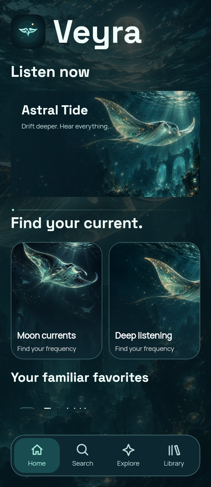 | 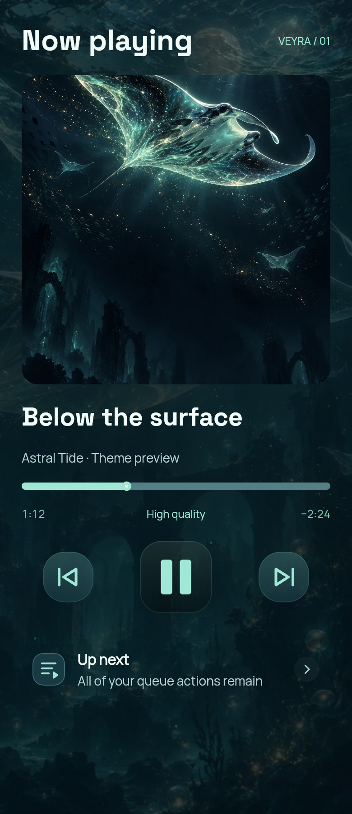 |

[Six native studies](previews/astral-tide) include 320 dp / 150% text Home and
compact Theme Studio. These are actual shared components in illustrative native
layouts, not Android device screenshots. [Validation and limits](../verification/ASTRAL-TIDE-0.1.7-beta1.md).
Rebuild this pack alone with `python3 themes/build_astral.py`.

The illustrations and vector manta-waveform mark are original AI-assisted Veyra
artwork, not a film/comic character or official franchise asset. Made by
Bhavishya Dalal. Space Grotesk and Manrope retain their included SIL Open Font
License notices; the bold Space Grotesk static instance is documented in the pack.

## Midnight Express · your next stop, another song

A quiet night journey through rain and mountains: warm carriage windows, an
art-deco reading lamp, coal-blue surfaces, amber controls and pale-blue details.
Bold Rajdhani headings evoke railway timetables while Manrope keeps body text
familiar. Thirteen weighted navigation/player/action glyphs, restrained ticket-like
corners and the existing parallel-strand/diamond timeline give it its own rhythm.
An original Veyra ticket-waveform mark ties Home branding to the optional launcher.
No film scene or real railway branding is used.

Schema 2 / minimum code 25. Existing playback, queue actions, actual song covers,
compact Studio, font scaling, RTL back icon and reduced-motion controls remain.
No background animation loop, new app dependency or engine schema is added.
The optional bundled launcher requires the refreshed preview source; earlier
code-25 installations can use the data pack without offering that icon.

| Home | Player |
| --- | --- |
| 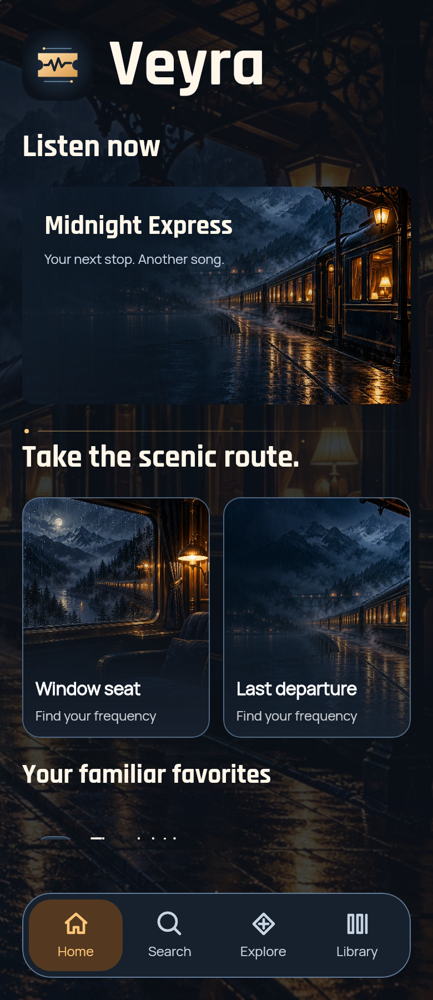 | 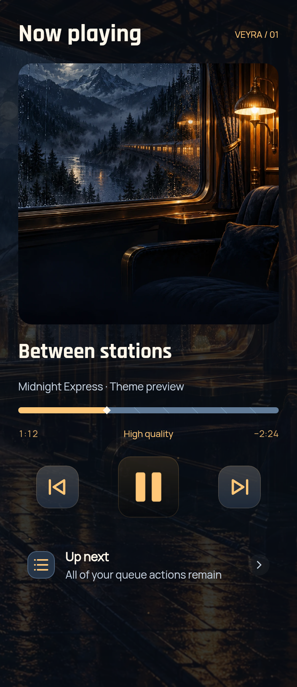 |

[Six new native component studies](previews/midnight-express) include Home and
Studio at 320 dp / 150% text. These are illustrative desktop Compose layouts
using shared components, not full Android device screenshots. See
[verification and limits](../verification/MIDNIGHT-EXPRESS-0.1.7-beta1.md).
Rebuild only this pack with `python3 themes/build_midnight.py`; the checked-in
artwork/fonts mean no generation service or network is needed to rebuild.
Original AI-assisted illustrations/vector glyphs by Veyra, made by Bhavishya Dalal.
Rajdhani Bold and Manrope retain their included SIL Open Font License notices.

## Reference collection — six more worlds

New AI-created compositions inspired by the owner's reference images. These are
data-only theme packs for **0.1.7-beta1 / code 25**. Stable 0.1.6 / code 22 does
not have the installer. Rebuild the latest preview source for the six optional
bundled launcher choices; theme application never selects a launcher automatically.

Each includes a scene, preview/banner/player mapping, an original waveform brand
mark, bold licensed fonts, thirteen functional glyphs, palette, control corners,
section decoration and timeline styling. The existing calm/reduced-motion engine
is reused; real album covers, accounts, playback and queue actions remain native.

| Theme | Art direction | Pack | Native studies |
| --- | --- | --- | --- |
| **Pumpkin Purr** | Cream ghost kittens, pumpkin lanterns and cocoa paper. Rounded Fredoka headings, soft corners, bubble timeline and an optional amber Glass Noir waveform icon. | [ZIP](packs/pumpkin-purr-v2.zip) · [SHA-256](packs/pumpkin-purr-v2.zip.sha256) | [Home](previews/pumpkin-purr/home.webp) · [Player](previews/pumpkin-purr/player.webp) · [RTL / large text](previews/pumpkin-purr/atmosphere-rtl-large-text.webp) |
| **Sunset Crew** | Coastal violet coupes and honey sunset. Unofficial SpongeBob / Patrick fan art; characters belong to Nickelodeon / Paramount, no affiliation. Bold Rajdhani headings, road timeline and an optional violet-and-honey Glass Noir icon. | [ZIP](packs/sunset-crew-v2.zip) · [SHA-256](packs/sunset-crew-v2.zip.sha256) | [Home](previews/sunset-crew/home.webp) · [Player](previews/sunset-crew/player.webp) · [RTL / large text](previews/sunset-crew/atmosphere-rtl-large-text.webp) |
| **Starry Spirits** | Gentle sheet ghosts under an original swirling teal-and-gold oil-painted sky. Space Grotesk headings, starlit timeline and an optional teal-and-gold Glass Noir icon. | [ZIP](packs/starry-spirits-v2.zip) · [SHA-256](packs/starry-spirits-v2.zip.sha256) | [Home](previews/starry-spirits/home.webp) · [Player](previews/starry-spirits/player.webp) · [RTL / large text](previews/starry-spirits/atmosphere-rtl-large-text.webp) |
| **Analog Reverie** | Warm walnut, smoked olive, vinyl and a luminous swallow. Bold Manrope typography, restrained player details and an optional champagne Glass Noir waveform icon. | [ZIP](packs/analog-reverie-v2.zip) · [SHA-256](packs/analog-reverie-v2.zip.sha256) | [Home](previews/analog-reverie/home.webp) · [Player](previews/analog-reverie/player.webp) · [RTL / large text](previews/analog-reverie/atmosphere-rtl-large-text.webp) |
| **Petal Promise** | Ivory stationery, dusky pink tulips, satin bows and watercolor hearts. Ivory artwork over readable plum-rose controls, rounded Fredoka headings and an optional rose Glass Noir waveform icon. | [ZIP](packs/petal-promise-v2.zip) · [SHA-256](packs/petal-promise-v2.zip.sha256) | [Home](previews/petal-promise/home.webp) · [Player](previews/petal-promise/player.webp) · [RTL / large text](previews/petal-promise/atmosphere-rtl-large-text.webp) |
| **Moonlit Herbarium** | Lavender wildflowers, ivory moths, a crescent moon and a small garden spirit. Space Grotesk headings, gold accents and an optional moonflower-waveform icon. | [ZIP](packs/moonlit-herbarium-v2.zip) · [SHA-256](packs/moonlit-herbarium-v2.zip.sha256) | [Home](previews/moonlit-herbarium/home.webp) · [Player](previews/moonlit-herbarium/player.webp) · [RTL / large text](previews/moonlit-herbarium/atmosphere-rtl-large-text.webp) |

Sunset Crew contains unofficial SpongeBob SquarePants and Patrick Star fan artwork;
the characters belong to their respective owners, including Nickelodeon / Paramount.
There is no affiliation or endorsement. This credit is also in the catalog
description and pack license. The owner's reference images are not redistributed.

All six scenes were created with AI generation. Current v2 launcher/Home marks are
AI edits of the official Glass Noir icon; functional glyphs retain their SVG sources
under `source-icons/`. The previous vector mark sources remain as historical artwork. Font files retain
their upstream OFL notices. Rebuild packs offline with
`python3 themes/build_reference_collection.py`; published versions are immutable.
The manifest-derived `render-config/` files keep the native study palettes/assets
aligned with the actual packs. Studies are desktop Compose components, not Android screenshots.

[Collection verification and device limits](../verification/REFERENCE-COLLECTION-0.1.7-beta1.md).

### Glass Noir icon refresh · collection pack v2

The six reference themes now use AI-edited variants of Veyra's current black-and-white
**Glass Noir** icon (`design/launcher/wave_glass.png`): the same connected silver
three-lobed waveform and dark glass case, with restrained theme-specific details.
The matching image is used on Home, in the launcher picker and in launcher density
assets. Android monochrome mode uses the official waveform silhouette. The default
Veyra icon remains unchanged.

Refresh Theme Studio, open the theme, choose **Download theme update**, then Apply.
Launcher selection stays explicit and optional. Rebuild the latest preview source
for the updated bundled launcher artwork. Published collection v1 packs are retained;
these are v2 theme updates, with the app still 0.1.7-beta1 / code 25.

[48 dp icon mask study](previews/pumpkin-purr/glass-icons.webp) · [Verification](../verification/GLASS-ICONS-0.1.7-beta1.md).
