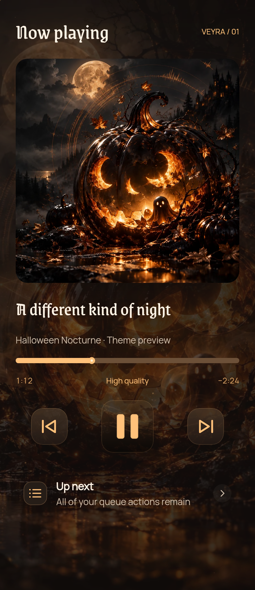
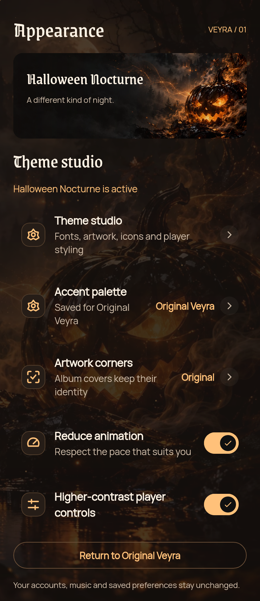
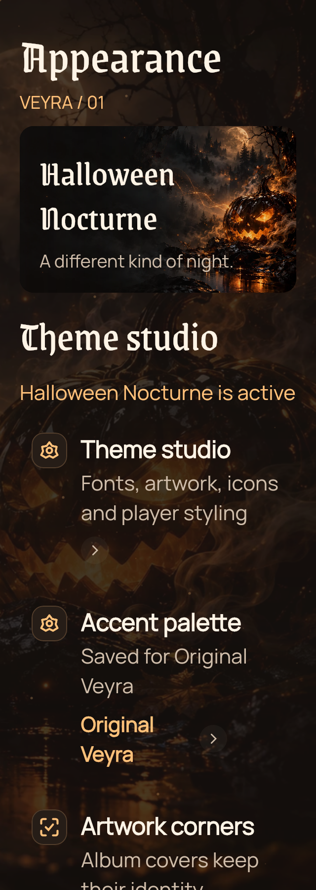
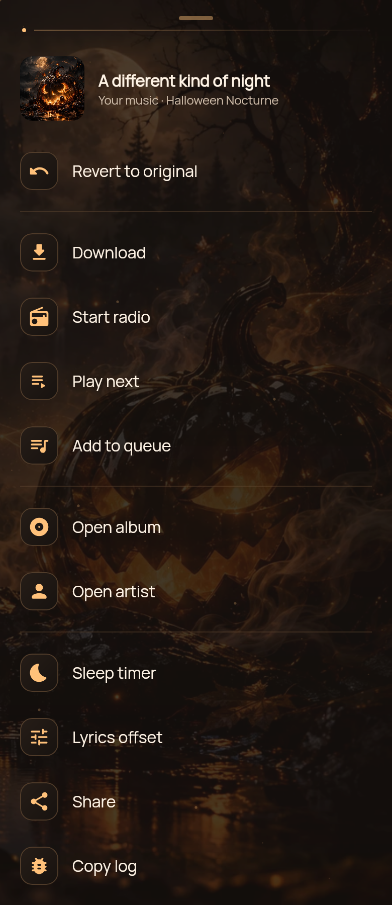
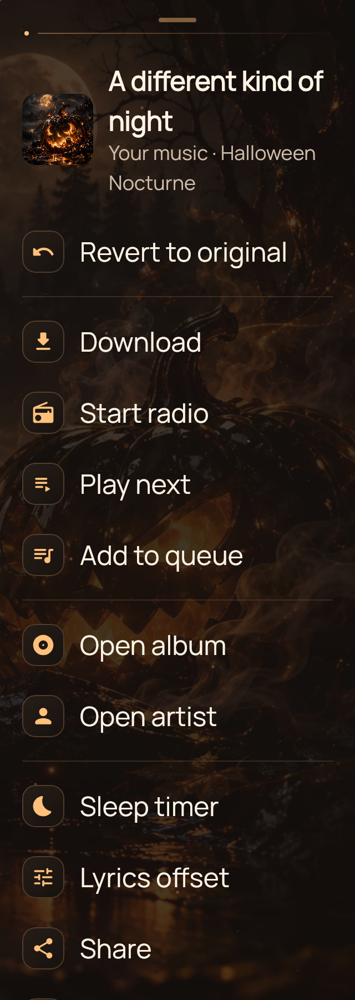

# Veyra Theme Studio · Halloween Nocturne

**For Veyra 0.1.7-beta1 / code 23 or newer theme-engine-compatible builds.**
Made by **Bhavishya Dalal**. Stable 0.1.6 does not contain the theme installer.

Smoked black glass, pumpkin amber, moonlit artwork and gothic display type.
Body copy stays readable; music artwork, navigation destinations and action
callbacks keep their original meaning.

[Download the theme ZIP](packs/halloween-nocturne-v2.zip) · [SHA-256](packs/halloween-nocturne-v2.zip.sha256)
· [Catalog](catalog.json) · [Manifest](halloween-nocturne/theme.json)
· [Offline preview gallery](index.html)

## Refined Halloween theme · pack v2

- New original moonlit-forest artwork and a persistent, darkened atmosphere behind
  main screens and Settings, including when Home is scrolled beyond its header.
- Amber frames on shared thumbnails and Home feature tiles, warmer caption
  gradients, ornamental section rules and a framed navigation surface.
- Song sheets and artwork-derived detail palettes now honor the active theme.
  Red album covers no longer turn the selected Halloween theme burgundy.
- Song menu icons have matching sculpted housings, a larger track thumbnail and
  clearer action groups. All existing actions and eligibility rules remain.
- Settings icon housings match the menu and player styling. Background layers
  have no pointer handlers, network fetches, continuous timers or shaders.

Build the latest preview source for the new interface changes. In Theme studio,
choose the version 2 update, download it, then Apply. Existing v1 installations
remain usable until you choose to update; the original v1 ZIP is preserved.

## Use it in the app

1. Open **Settings → Appearance → Theme studio** in the new beta.
2. Choose **Halloween Nocturne → Download theme**. Progress and Cancel are available.
3. After validation, tap **Apply theme** and confirm **Apply & restart UI**.
4. The Activity refreshes; the playback service is not stopped. Installed themes
   work offline. **Later** leaves the current appearance unchanged.
5. Choose **Original Veyra** to restore the saved base appearance. Inactive themes
   can be removed with confirmation, then downloaded again later.

The catalog is seeded in the app and refreshed when Theme studio opens. Future
compatible theme versions download separately; downloading does not activate an
update or change the currently active pack. Packs requiring a newer app are gated.

## Native component previews

These are **Compose component studies**, not whole-app emulator/device screenshots.
The artwork shown as a sample album cover is demonstration art. The real player
keeps the listener's actual album artwork; themed atmosphere is an additional
low-opacity decorative layer. The actual navigation bar keeps its existing native
glass implementation, labels, touch handling and destinations.

| Home study | Player controls study |
| --- | --- |
|  |  |

| Settings study | 320 dp, 150% text study |
| --- | --- |
|  |  |

| Song actions study | 320 dp, 150% text action study |
| --- | --- |
|  |  |

The action studies use the real shared background/icon housing with illustrative
menu rows; the Android sheet itself is checked by Android Kotlin compilation,
not rendered as a full Android window here.

## What a theme can change

| Component | Theme-owned presentation | Preserved behavior |
| --- | --- | --- |
| App screens | Dark palette, surfaces, heading/body fonts, Material shape roles | Content, route hierarchy, system font scaling |
| Home / Settings | Persistent atmosphere, artwork frames, section details and icon housings | Songs, account access, search and scroll state |
| Navigation | Home/Search/Explore/Library glyphs, container radius and colors | Labels, accessibility roles, destinations and gestures |
| Player buttons | Native framed surfaces, corner geometry and transport icon assets | Play/pause/skip, busy/locked states, haptics, touch targets |
| Player timeline | Accent fill, track thickness and ember playhead | Seek gestures, RTL, elapsed/duration, loading/mix feedback |
| Common actions | Back, download, queue, lyrics and appearance icon slots where vector icons are used | Original callbacks and account rules |

Service logos, album art and unsupported specialty glyphs stay original. Theme
packs are **not executable skins** and cannot introduce arbitrary screens,
replacement button logic or uncontrolled animations. Existing motion/accessibility
preferences continue to apply. Return to Original Veyra to use the saved base
palette again; theme activation never rewrites those preferences.

## Validation and storage

Catalog/pack downloads are restricted to this repository's exact HTTPS paths.
The ZIP checksum, manifest schema/app requirement, every file hash, canonical
paths, entry count, unpacked size, palette contrast and geometry are checked.
Android image bounds, SFNT font signatures and native font loading are checked
**before** an installation becomes visible. Temporary files are removed after
failure/cancellation. Invalid saved themes fall back to Original Veyra at startup.

Limits: ZIP 12 MiB; 48 asset files plus manifest; 8 MiB per file; 32 MiB total;
artwork at most 2048×2048; icons at most 256×256. No scripts, code, remote asset
references, symlink restoration or absolute/traversing paths. Installed assets live
in the app's private files directory. Active selection has its own preference
namespace and does not interfere with account/music backup data.

## Rebuild

Artwork and licensed fonts are committed; no image-generation service or font
network request is needed to rebuild the pack.

```sh
python3 -m pip install -r themes/requirements.txt
python3 themes/build_halloween.py
```

This rebuilds original SVG/PNG glyphs, asset hashes, deterministic ZIP, checksum
and catalog. A changed published pack must bump its theme version and catalog
entry; never replace different assets under an existing immutable version.

Native rendering instructions and limits: [renderer](../verification/theme-preview/README.md).
Font notices are included alongside the fonts. The original generated atmosphere
and vector icons are credited in [artwork licensing](halloween-nocturne/licenses/ARTWORK.txt).
