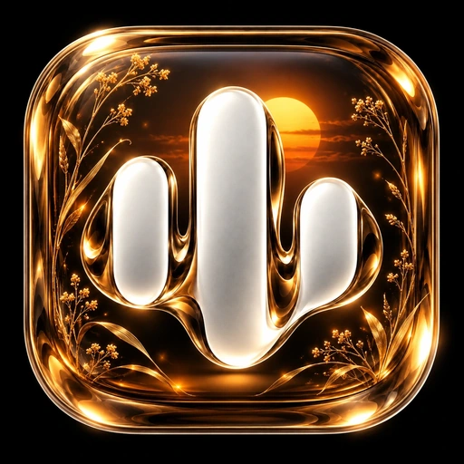
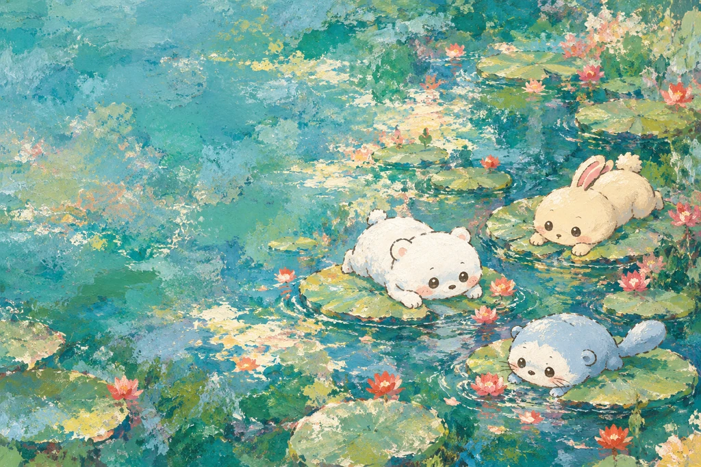
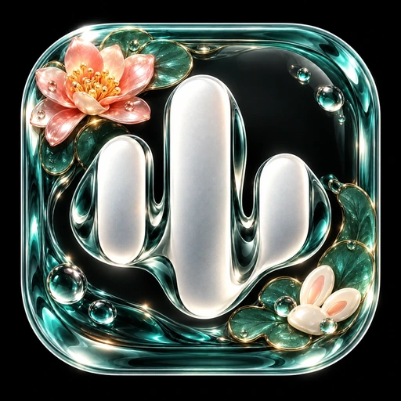
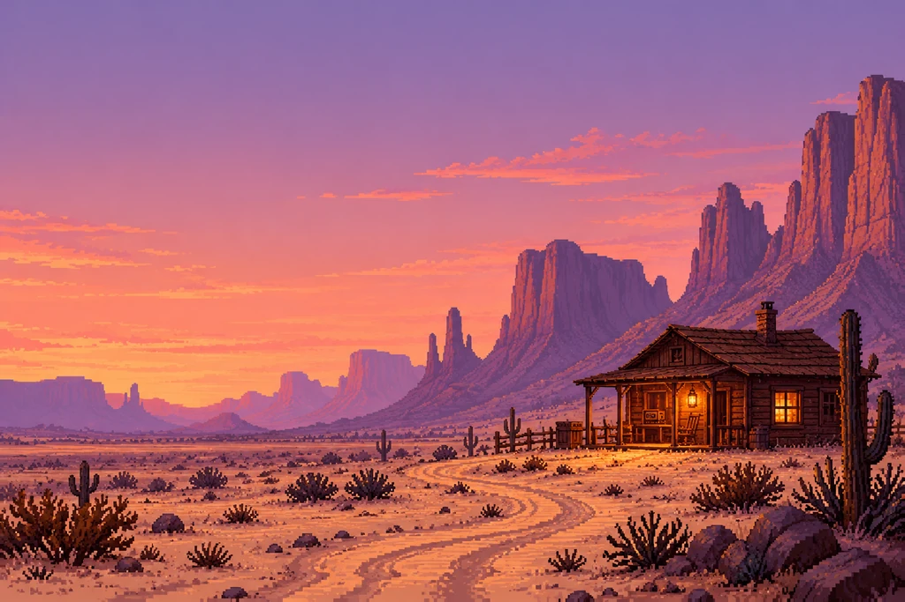
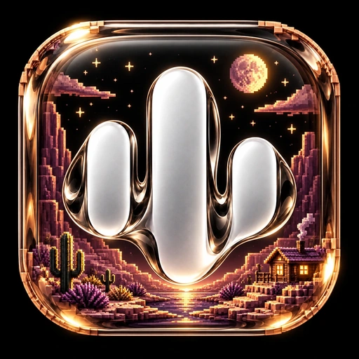
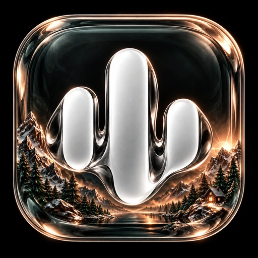
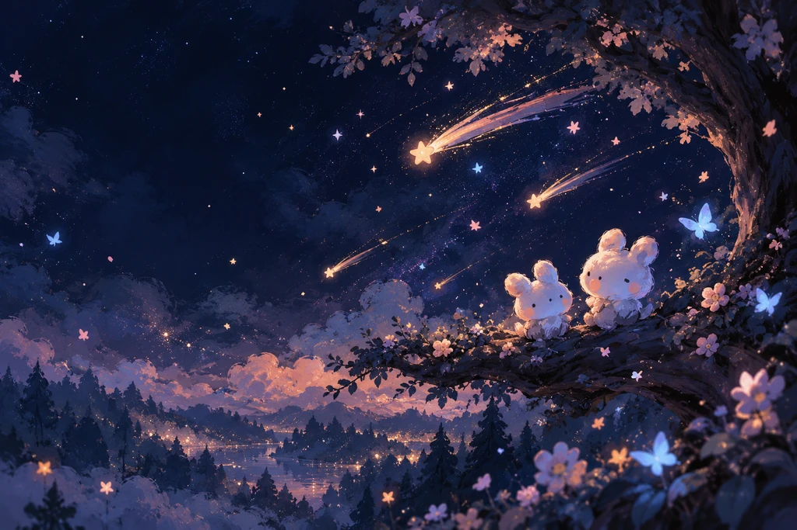
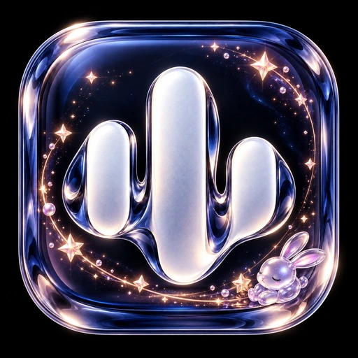

# Wayfarer — five new Veyra worlds

For the latest **0.1.7-beta1 / code 25** preview. Stable 0.1.6 is unchanged and cannot load these packs.

Open **Settings → Appearance → Theme studio**, Refresh, select a theme and Download → Apply. Matching launcher selection is an **explicit optional checkbox**. Rebuild the latest preview source to obtain the new bundled launcher aliases and bottom-bar polish. Theme ZIPs are data packs, not APKs.

| Theme | World | Download |
| --- | --- | --- |
| **Golden Afterglow** | Cinematic amber meadow and dusk silhouettes. Bold Manrope, bronze-and-olive controls, meadow navigation glyphs and an optional sunset-glass Veyra icon. | [ZIP](packs/golden-afterglow-v1.zip) · [SHA-256](packs/golden-afterglow-v1.zip.sha256) |
| **Lilypond Parade** | Original pond pals and impressionist lily pads. Fredoka headings, jade surfaces, bubble timeline, lily navigation glyphs and an optional bunny-charm glass Veyra icon. | [ZIP](packs/lilypond-parade-v1.zip) · [SHA-256](packs/lilypond-parade-v1.zip.sha256) |
| **Dustbyte Outpost** | Pixel-art desert cabin, mauve mesas and copper dusk. Bold Rajdhani, stepped navigation glyphs, route timeline and an optional miniature desert-diorama Veyra icon. | [ZIP](packs/dustbyte-outpost-v1.zip) · [SHA-256](packs/dustbyte-outpost-v1.zip.sha256) |
| **Alpine Ember** | Pixel-art mountain cabin, mirrored lake and rose-gold dawn. Space Grotesk headings, pine-and-slate controls, mountain navigation glyphs and an optional alpine glass Veyra icon. | [ZIP](packs/alpine-ember-v1.zip) · [SHA-256](packs/alpine-ember-v1.zip.sha256) |
| **Starfall Pals** | Original moon-bunny friends under painterly shooting stars. Fredoka headings, ink-blue glass, peach starlight, star-navigation glyphs and an optional celestial bunny-glass Veyra icon. | [ZIP](packs/starfall-pals-v1.zip) · [SHA-256](packs/starfall-pals-v1.zip.sha256) |

Every pack includes an original AI scene mapped to banner/player/preview, a matching Home brand mark, licensed heading/body fonts, thirteen custom functional glyphs, palette, geometry and timeline styling. The four navigation glyphs have a distinct motif for each world while retaining the home, magnifier, compass and books meanings.

Both bottom-bar styles now use a readable themed tonal material with static bubble, route or light-line detailing. Labels and native selection states remain visible. The themed floating bar permits two-line labels; neither surface needs a permanent animation or expensive live blur. Theme changes invalidate cached glass tab content. Affected tint and press feedback respects app/system reduced motion.

Routes, drag switching, accounts, real music artwork, playback, queue actions and every existing theme/icon remain available. Glass Atelier remains a separate collection. The new Home/launcher marks keep Veyra's official silver waveform and black glass identity, with more detailed miniature worlds and charms.

## Artwork and native studies

These are native Compose component studies with illustrative surrounding content, **not Android screenshots**. The navigation studies share the actual themed floating-bar item and surface, and show all four selection states at 320 dp / 150% text. The platform glass folding host and real-device launcher are not emulated.

### Golden Afterglow

[Home](previews/golden-afterglow/home.webp) · [Player](previews/golden-afterglow/player.webp) · [Large-text navigation](previews/golden-afterglow/navigation-large-text.webp) · [RTL navigation](previews/golden-afterglow/navigation-rtl-large-text.webp)

### Lilypond Parade

[Home](previews/lilypond-parade/home.webp) · [Player](previews/lilypond-parade/player.webp) · [Large-text navigation](previews/lilypond-parade/navigation-large-text.webp) · [RTL navigation](previews/lilypond-parade/navigation-rtl-large-text.webp)

### Dustbyte Outpost

[Home](previews/dustbyte-outpost/home.webp) · [Player](previews/dustbyte-outpost/player.webp) · [Large-text navigation](previews/dustbyte-outpost/navigation-large-text.webp) · [RTL navigation](previews/dustbyte-outpost/navigation-rtl-large-text.webp)

### Alpine Ember

[Home](previews/alpine-ember/home.webp) · [Player](previews/alpine-ember/player.webp) · [Large-text navigation](previews/alpine-ember/navigation-large-text.webp) · [RTL navigation](previews/alpine-ember/navigation-rtl-large-text.webp)

### Starfall Pals

[Home](previews/starfall-pals/home.webp) · [Player](previews/starfall-pals/player.webp) · [Large-text navigation](previews/starfall-pals/navigation-large-text.webp) · [RTL navigation](previews/starfall-pals/navigation-rtl-large-text.webp)

## Provenance and rebuilding

Ten AI image generations/edits used the owner's references for atmosphere and the official `design/launcher/wave_glass.png` for all five icons. The original attachment files are not redistributed. Lilypond and Starfall use original animal designs. Functional glyph SVG sources are checked in under `source-icons/<theme>/`; fonts retain their included SIL Open Font Licenses. Existing third-party attribution is preserved.

Rebuild only this collection offline with `python3 themes/build_wayfarer_collection.py`; Python asset dependencies are listed in `requirements.txt`. This calls the existing immutable compiler without rewriting earlier packs. Published v1 bytes are fixed; any future asset change requires a new pack version. Manifest-derived `render-config/` files drive the native studies.

Generated study images remain in the repository/gallery. Android source ZIPs include the renderer and all theme source assets/packs while omitting duplicated generated images under `themes/previews/`.

[Verification and remaining device limits](../verification/WAYFARER-COLLECTION-0.1.7-beta1.md) · [Full theme catalog](README.md)
