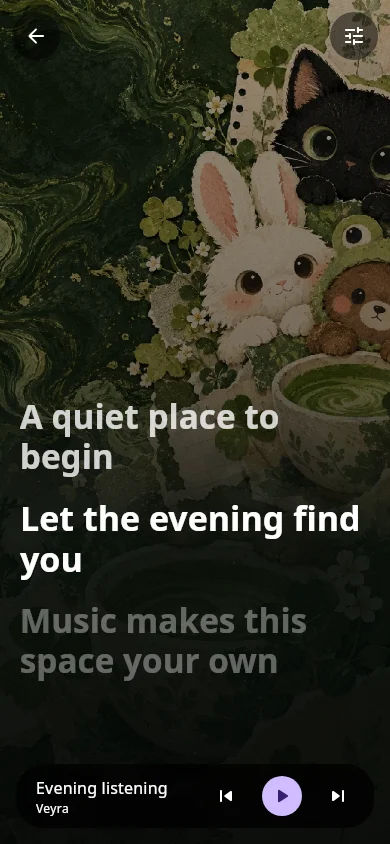
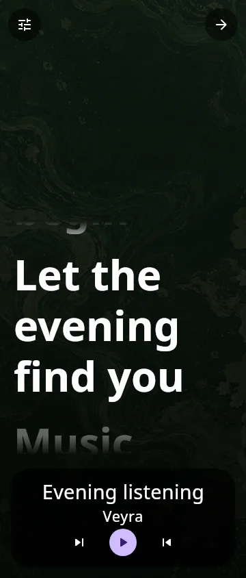

# Beta 0.1.8 — experience foundation, stage 1

Preview source · 0.1.8-beta1 / code 27 · 2026-10-21

**This is the first implementation checkpoint of the approved roadmap, not a claim that all proposed features are complete.** The [full checklist](../docs/roadmap/BETA-0.1.8-EXPERIENCE.md) explicitly retains every pending item.

## Implemented

- **Immersive mode:** enter from the playing song's menu or Appearance → Your listening experience. Song, theme, blended and minimal backdrops; fill/fit/zoomed artwork; top/center/bottom/full lyrics; existing word-timed renderer, timing/source/song menus; swipe skip; permanent exit; transient system bars and foreground screen-on handling. Large-text metadata and transport stack vertically. Normal-player video content leaves composition while immersive is mounted, avoiding two cover decoders.
- **Five widgets:** Sleeve, Vinyl, Studio Strip, Lyrics and Listening Studio, alongside the existing three. Each has its own registered provider, resizing bounds and vector launcher preview. Native RemoteViews controls share the current session actions and deep-link restoration. Theme/style palettes and optional local theme art are read on rendering. Artwork is bounded and cached; refreshes are conflated/serialized, identical state is skipped, and there is no periodic widget timer or animation. Lyrics use the service's existing changed-line events; the Studio waveform is decorative and static.
- **Home:** optional Speed Dial from existing recent/provider shelves, a custom greeting, up to six shortcuts and a Quick Picks list/radio preference. Defaults preserve the prior Home. Controls route through existing permission, offline playback, sign-in and queue handlers. Large text reduces the tile column count.
- **Navigation:** two to five ordered destinations, optional Local Music/Replay/Settings, startup destination, label visibility and non-glass floating/docked/minimal shapes. Home remains reachable. Stable destination keys keep themed icons correct after reordering; existing four content-root IDs do not change. Glass navigation retains its integrated shape/mini player.
- **Player:** optional bounded double-tap and hold seeking, total/remaining duration, transport decoration and scrubber presets, output caption visibility and pause-artwork scaling. Non-glass mini player adds pill/card/slim shapes, Next visibility and line/fill progress. The playhead is read in drawing scopes rather than at the app root.
- **Fonts:** independent TTF/OTF app/lyrics imports up to 4 MB, checked before activation and decoded off the UI thread. Immutable hashed references cannot become arbitrary file paths. App imports apply to Original; custom styles keep their coordinated typography. Lyrics sizing and centering retain duet direction handling. Choosing a built-in app font clears its import override.
- **Data/network:** metered Data Saver bounds supported unsigned image URLs, disables motion covers and speculative Home/search warming, and restricts queue preloading. Signed/custom/local URLs stay intact. Preload offers opening/whole next/next three with a cellular permission; extra byte fetches remain sequential and preserve source pinning. Content-country overrides are validated ISO codes; changing one invalidates search cache and refreshes discovery feeds.
- **Backup:** schema 2 includes the two selected font blobs and appearance preferences, retains schema-1 reading, excludes existing secret/device-local keys, caps documents at 32 MB and validates asset names. Restore first previews metadata, then checks the document hash before mutation. Existing manually saved audio is not included/deleted.
- **Lifecycle fixes:** service lyric lookups cancel and clear old state before changing tracks, reject another track's response and publish a completed lookup while paused. Changing lyric source order/priority now participates in the service's lookup key. Root navigation and root typography observe only the preferences they consume, so greeting edits do not invalidate those roots.

## Verification

- `:app:compileProdReleaseKotlin` — passed on final source.
- `:app:testProdDebugUnitTest` — **43 focused tests passed** across experience policy, backup documents, search work, style isolation, queue URL warming, Home/recovery/undo and download work ownership.
- `:sharedUi:compileKotlinJvm` — passed; desktop native render tasks also compiled final shared UI.
- `:sharedUi:jvmTest --tests app.veyra.music.ExperienceRenderTest` — **2 tests passed**, exercising seven native captures: four immersive backgrounds, immersive at 180% text with RTL layout, and Home tiles at normal/180% RTL text. They also invoke exit/play/next and shortcut/tile semantic actions. Final render logs contain no asynchronous errors.
- Website build/type checks and both mobile/desktop download-link tests — passed.
- Regression coverage caught a Java/Android SDK `List.removeLast()` compatibility issue; normalization now uses `removeAt(lastIndex)`. Backup checks reject unrelated/incomplete JSON and future schemas before restoration.

Native offscreen captures (production shared components, fixture player and local theme art):

| Immersive blend | Theme artwork, large text and RTL |
| --- | --- |
|  |  |

[Home tiles](../themes/previews/experience-0.1.8/home-tiles-normal.webp) · [Home tiles at 180% and RTL](../themes/previews/experience-0.1.8/home-tiles-large-rtl.webp)

Visual inspection led to explicit Home caption colors, an opaque capture surface, loaded-art assertions, a cached artwork fade and stacked large-text immersive controls. Earlier development failures were corrected and rerun; they are not counted as passing verification.

## Limits and pending device work

No APK assembly, Actions dispatch, stable promotion or backend change. Native offscreen rendering does not verify Android dialog/window flags, gesture dispatch, launcher RemoteViews, process restarts, imported-font parsing on every Android release, network throughput, battery use or sustained FPS. Existing compiler warnings remain; no clean-lint claim.

The native render harness uses the production shared UI with a test player host and local artwork. It bypasses the Android window for capture. It validates layout/semantics and callback reachability, not actual audio playback or provider availability.

Source ZIPs omit generated `themes/previews/` images while retaining their test renderer and the source artwork. Stable theme packs, stable Android branches and existing room-server configuration are unchanged.
