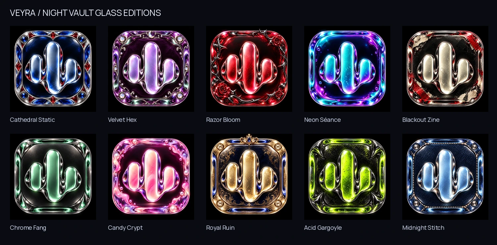

# Stable 0.1.9 · Night Vault glass icons · build 39

The ten Night Vault launcher editions previously used flat SVG illustrations. They now use individually AI-generated glass masters based on the earlier Chrome Venom and Riot Candy Veyra icons: the same connected three-bar identity, with raised translucent forms, reflective bevels and distinct sculpted frames.

| Edition | Glass treatment |
| --- | --- |
| Cathedral Static | Sapphire and ruby crystal with silver tracery |
| Velvet Hex | Amethyst, opal, silver filigree and a crescent |
| Razor Bloom | Crimson glass, dark chrome thorns and ruby roses |
| Neon Séance | Spectral cyan and violet liquid crystal |
| Blackout Zine | Smoked glass over ivory paper and red punk tape |
| Chrome Fang | Mint crystal and sharply sculpted gunmetal |
| Candy Crypt | Pink/lilac jelly glass, pearls and batwing details |
| Royal Ruin | Champagne crystal, gold and sapphire crown details |
| Acid Gargoyle | Chartreuse glass, obsidian and dark chrome corners |
| Midnight Stitch | Ice-blue crystal over denim and silver stitching |

## Implementation

- Ten reviewed 512px WebP masters replace the flat artwork at the existing resource paths. There are 100 native density exports; no runtime image generation, animation or download is added.
- Existing aliases, picker filters, matching-icon actions and Home's selected launcher painter continue to use the same resource bindings. Version code **39** also invalidates the selected-icon cache after updating.
- Android monochrome icons retain the canonical `ic_wave_monochrome` vector. Android's system themed-icon option can therefore show monochrome; choose the full-color icon to see the glass artwork.
- `scripts/build_night_vault_icons.py` exports the reviewed masters. The asset builder calls this exporter rather than repainting launchers from the historical flat SVG studies. The shipped WebP masters are sufficient for a reproducible resource export; original generated PNG paths are provenance only.
- [Generation provenance and master hashes](../design/launcher/night-vault/generated-sources.json) · [actual icon gallery](../design/launcher/night-vault/previews/index.html).

All 62 theme packs, all 15 asset packs and older launcher editions remain unchanged. Stable remains **0.1.9**, now **code 39**; completed beta and historical stable branches remain separate.

## Focused verification

- Production release Android resources and Kotlin compilation passed; debug build metadata generated with code 39.
- `verify_night_vault.py` checks all ten master hashes, all 100 exact density exports and canonical monochrome references; all 77 catalog checksums/URLs, published pack bytes, older launcher masters and three retained preview archives are preserved.
- The icon-binding probe verifies all 105 launcher choices, all 62 theme and 15 asset mappings, native resources, manifest aliases and picker filters.
- Website production build, typecheck and mobile/desktop link/layout checks cover the updated notes, gallery, stable source/checksum and retained preview links.
- The source ZIP is repackaged with the new resources and checksum. This is source publication, not a signed APK release. Rebuild and install code 39 to see the replacements; launcher masking and refresh behavior still depend on the device launcher.

This icon-only change does not establish device FPS or retest unrelated playback behavior. Build 38 fixes and their checks remain documented in [the preceding patch notes](PATCH-0.1.9-BUILD-38.md).
