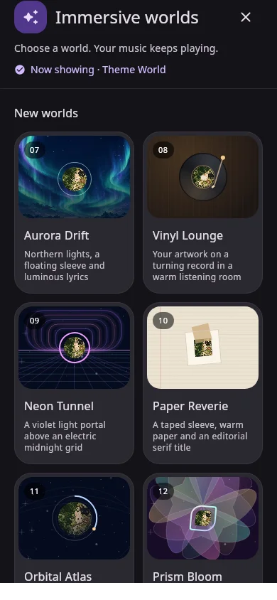

# Stable 0.1.9 · Immersive gallery · build 40

The immersive picker now presents the six modes as visual posters rather than a vertical settings list. Tap a poster to switch immediately; the existing mode preferences and playback ownership remain intact.

## Design

- A pinned heading, active-mode label and explicit Close action stay above the scrolling gallery.
- Each poster has a mode-specific composition, numbered corner marker, title and readable description. The selected mode has a strong outline and check badge, plus radio-selection semantics for accessibility.
- Normal phone widths use two columns; wide sheets use three. Large text and narrow windows use one. Cards in each row share a height, text wraps, and large-text headings reserve space for Close.
- The sheet opens fully, with rounded upper corners and theme-colored surfaces. **Customize Classic** groups its background, cover fit and lyric position; **More controls** groups lyric source/timing and song options. Cinema and Minimal Night omit irrelevant lyric actions.
- Existing theme artwork and the current song cover feed the previews. Missing artwork has a designed native fallback. Preview requests are bounded to 192px and use the existing image cache; there are no miniature live players, video decoders, ticking playheads or new blur effects in this menu.

## Actual production-component captures

These are native offscreen renders of the production menu, not AI mockups. Phone and wide captures use fixture artwork; the large-text RTL capture intentionally has no artwork to exercise the fallback.

[Phone](../themes/previews/immersive-worlds/menu-phone.webp) · [Wide](../themes/previews/immersive-worlds/menu-wide.webp) · [Large text / RTL](../themes/previews/immersive-worlds/menu-large-rtl.webp)

## Focused verification and delivery

- Production Android release resources/Kotlin compile and debug build metadata generation pass for stable **0.1.9 / code 40**.
- The focused native menu render check covers phone, wide and 1.8× text/RTL layouts, all six selectable modes, a single selected state and the Close callback. It also checks fixture image decoding and the missing-artwork fallback.
- Website production build, typecheck and mobile/desktop source-link/layout checks cover the updated notes and retained stable/beta links.
- Source packaging/checksum verification preserves the three completed beta archives. Existing theme/asset packs, glass launcher artwork and historical branches are unchanged.

Rebuild and install **code 40** to get this menu. A source ZIP or Git push does not publish a signed APK. Offscreen renders and compilation do not establish real-device FPS; physical launcher behavior and device animation performance remain device-testing concerns.

Earlier updates: [build 39 glass icons](GLASS-ICONS-0.1.9-BUILD-39.md) · [build 38 playback/Home fixes](PATCH-0.1.9-BUILD-38.md).
