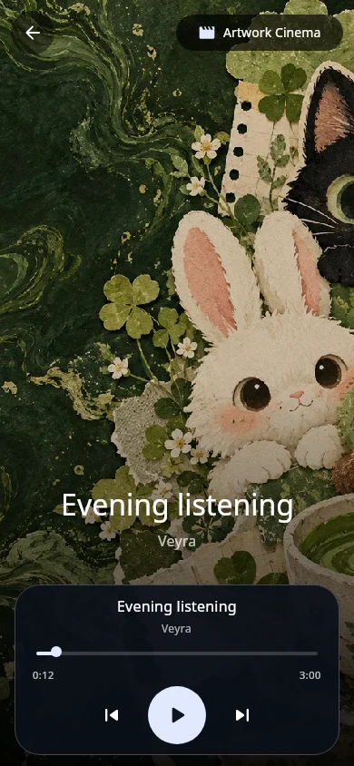
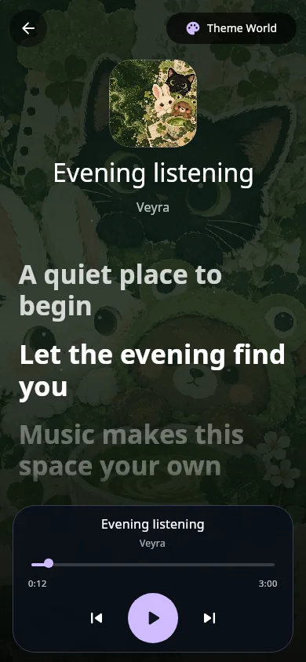
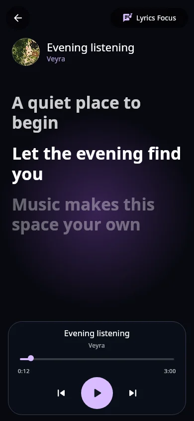
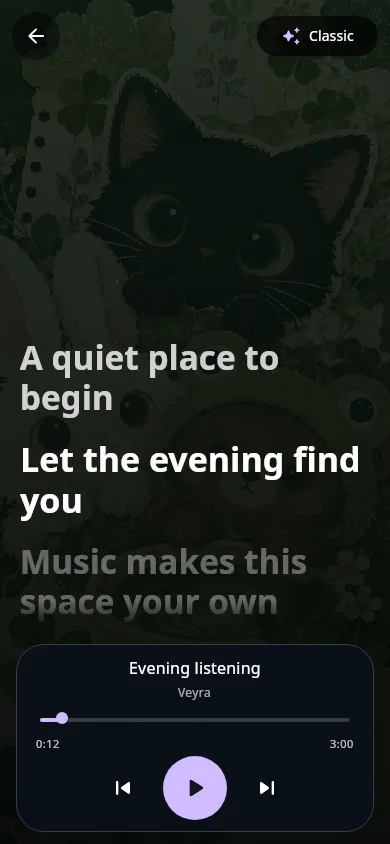
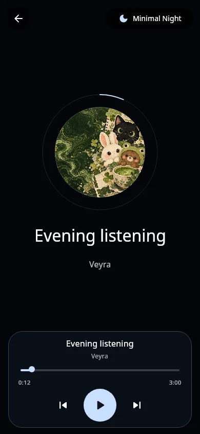
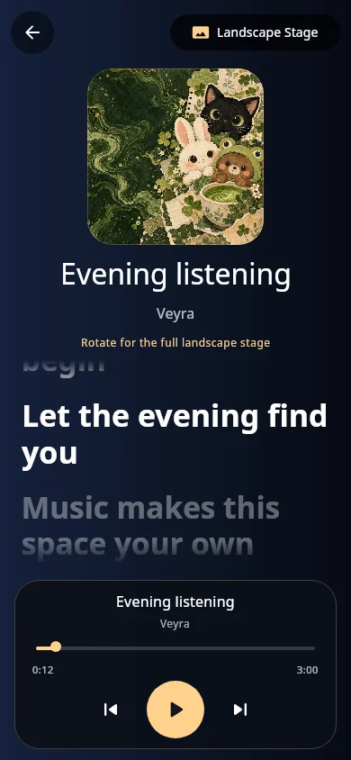
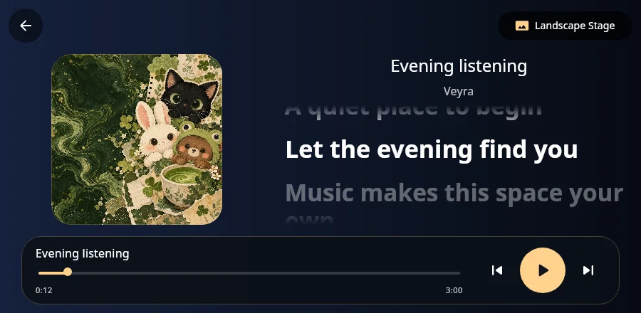

# Immersive Worlds · stable 0.1.9 / build 37

Open the full player and use the **Immersive mode** expand button beside the menu. The button is available in portrait and landscape. Existing menu/Settings access is retained.

## Six presentations

| Mode | Presentation |
| --- | --- |
| Classic | Original configurable song/theme/blended/minimal background with artwork-fit and lyric-position choices |
| Artwork Cinema | Edge-to-edge current song artwork, a dark cinematic scrim and prominent track identity |
| Theme World | Applied theme scenery, small song sleeve, identity and shared lyrics; neutral fallback when no theme is active |
| Lyrics Focus | Violet light-field background, compact song header and the existing synced-lyrics renderer |
| Minimal Night | Near-black background, circular artwork and an orbital real-progress arc |
| Landscape Stage | Artwork and lyrics in two columns in wide windows; stacked layout and a rotation hint in portrait |

All new modes use real current media. Missing artwork retains native gradients/music glyphs; missing lyrics show the existing fallback. No fictional song artwork, prerecorded lyric text, extra media player, new theme pack or forced screen orientation is introduced.

## Controls and menu

- Always-visible Return to player and selected-mode button.
- Six described, selectable mode cards in a scrollable bottom sheet.
- Explicit labeled chips for Classic's existing background/fit/placement options.
- Shared playback dock with previous, 64dp play/pause, next, song identity and real seek/time controls. Wide windows use a horizontal dock.
- Seeking clamps to a positive finite duration, is unavailable when controls are locked/track duration is unknown, and pauses dock auto-hide during a drag. Song changes clear a pending seek preview.
- Lyrics source, timing and song-options actions remain available in the mode sheet.

`ExperienceOptions.immersiveStyle` persists the selection, defaults legacy preferences to Classic and coerces unknown future enum values to the same safe default. Leaving immersive mode preserves the saved style.

The same playback callbacks and `PlaybackPosition` are used throughout. The orbital progress reads the playhead during drawing; the seek/time leaf reads it locally. New backgrounds are static native gradients/artwork, with no added animation clock, screen-sized blur or decoder. Classic motion covers also respect Data Saver and the existing reduced-animation setting. Theme scenery follows its shared motion controls.

The AI concept board was a visual direction. This implementation renders native layouts around real artwork and lyrics; it does not install its fictional scenery or promise a pixel-identical generated mockup.

## Verification

Results recorded after focused compilation, preference checks and the production render probe. Real-device installation, rotation, TalkBack, live stream behavior and frame-rate measurements remain separate checks. No APK is built or signed by source publication.

### Focused results

- Production Android release Kotlin compilation passed, along with the shared JVM UI compilation.
- `CheckImmersiveOptions.java` checks the actual compiled preference codec: all six styles round-trip; legacy settings and an unknown future style retain Classic and the saved background choice.
- The focused `ExperienceRenderTest` renders all six styles, 180% text/RTL Lyrics Focus and a wide Landscape Stage. All eight cases invoke Return to player, Play and Next through their accessible actions and check their on-screen bounds. This is an offscreen production-UI check with local fixture art, not a device FPS benchmark.
- Website build/type checks and 390px/1366px source/checksum/release-note/retained-preview link checks passed, without page errors or horizontal overflow.
- Source packaging validates per-file hashes/CRC and backend provenance; archive verification retains one current stable and all three unchanged preview ZIPs. Existing published theme/asset packs are unchanged.

### Native layout captures

These are production Compose components rendered offscreen using fixture song text, local Matcha artwork and paused playback. They are separate from the earlier AI concept board. Capture files remain in Git; source ZIPs omit these generated studies.

| Artwork Cinema | Theme World | Lyrics Focus |
| --- | --- | --- |
|  |  |  |

| Classic | Minimal Night | Portrait Stage |
| --- | --- | --- |
|  |  |  |

[Large-text RTL capture](../themes/previews/immersive-worlds/immersive-lyrics_focus-large-rtl.webp).
