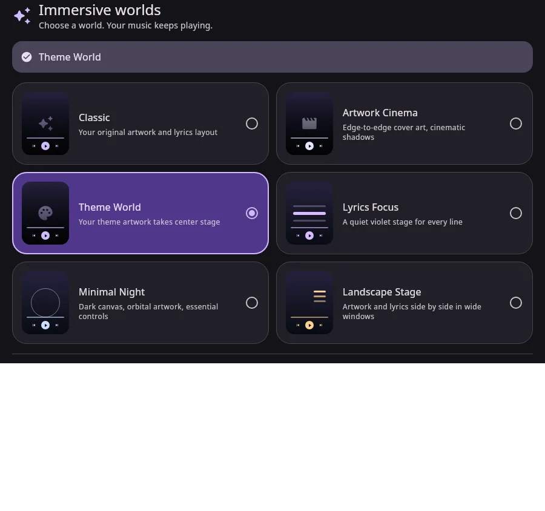

# Stable 0.1.9 · build 38

## Playback controls

The app previously used `isPlaying` for the transport icon and toggle command. That becomes false during buffering even when the user has requested playback. The main and mini-player controls could consequently show Play, issue another Play command, or replace the action with an inert spinner.

- `PlayerState.playWhenReady` now carries transport intent separately from the actual audio clock; ended playback shows Play and restarts from its default position.
- Full player, floating/folding mini-player and immersive controls follow transport intent. Audio-dependent lyrics/motion still follow actual playback.
- The full-player toggle remains actionable while buffering, with a small busy badge; reduced motion uses a static badge. Mini-player actions remain present during loading.
- Themed normal/pressed transport painters are keyed by semantic asset path, preventing a prior action's painter from being retained in the new action's slot.

## Home recovery and artwork

An empty offline/cached Success is no longer treated as useful content that must block fallback results. Returning to an empty/failed Home retries when no request is active. Core refresh has a 20-second coroutine deadline; existing useful content is retained during refresh/failure, and placeholder-only shelves are filtered out.

Home artwork now has a theme-colored music fallback underneath loading/missing/failed images. Refresh and Retry recreate failed artwork requests while successful images can still reuse Coil caches. Custom Home-style artwork also participates in this retry scope.

## Immersive menu and covered pages

Six described preview cards now include native miniatures, a selected-mode summary, adaptive one/two-column layout and readable large-text presentation. Classic keeps its background/fit/lyrics choices. **More controls** groups song options and the lyric actions relevant to the selected mode. Preview requests are bounded to 96px and do not start video players.

`CoveredAppPages` removes covered Home/navigation/detail content from composition while immersive mode is open. Its effects and animations stop; saveable UI and root-owned scroll state remain available on exit. The ordinary player's visual branch already returns early; its unused sleeve/palette analysis is now suppressed and non-Classic immersive styles do not fetch regular-player motion covers. Playback, queue and essential services continue.

## Night Vault

Ten new independent packs, 1,190 runtime asset roles and ten matching canonical-wave launcher editions. Total: **62 themes, 15 asset packs, 105 launcher choices**. Existing published packs and launcher masters are preserved. [Real assets, fonts, icon previews and compatibility](../asset-packs/NIGHT_VAULT.md).

## Focused verification

- Production Android release Kotlin/Java compilation passed; stable version remains 0.1.9 with code 38, including generated debug metadata.
- Six native `ExperienceRenderTest` checks passed: buffering transport and immersive Pause→Play→Pause actions, covered-page effect disposal/saved-state restoration, empty Home filtering, adaptive menu captures, existing immersive layouts and personalized Home actions. The final miniature fallback refinement was compiled and its menu render check repeated.
- Actual production installers accepted all 15 packs, decoded PNG/font assets and checked exact archive membership, checksums, roles, minimum codes and supported presets.
- 930 theme/asset combinations preserved theme identity, artwork and palette, plus category restoration and font-only/custom-scene isolation.
- Actual enum/manifest/picker checks verified 105 choices, all 62 theme and 15 asset mappings, unique default and unknown-ID rejection.
- `verify_night_vault.py` checks ten waveform masters, 100 density exports, shared monochrome references, all 77 catalog hashes/URLs, existing packs/icons and the three retained preview archive bytes.
- Production catalog parsers accepted 62 themes/15 asset packs and identical bundled fallbacks; stable parsers rejected beta URL roots.
- Website production build, type checks and relevant mobile/desktop links/layout are verified before publication. Source archive checks validate CRC, per-file hashes, backend provenance and four-archive retention.

These checks are not a device installation, live-provider reliability test, R8 APK assembly, battery benchmark, TalkBack session or frame-rate measurement. Device verification of the reported intermittent issues remains necessary after installing the rebuilt APK.

## Native menu captures

Production sheet body with missing-artwork fallback fixtures; generated offscreen, not AI art or Android device screenshots:

[Large-text RTL menu](../themes/previews/immersive-worlds/menu-large-rtl.webp).

## Source packaging

All source/build resources, launcher masters, runtime packs and font licenses remain included. Duplicate public/offline asset-preview images can be restored from checksummed pack mappings. Generated captures under verification's atelier/performance/reliability preview folders remain in Git and are omitted from source ZIPs, as other generated galleries already are. Renderer/test sources and actual build inputs remain included.
